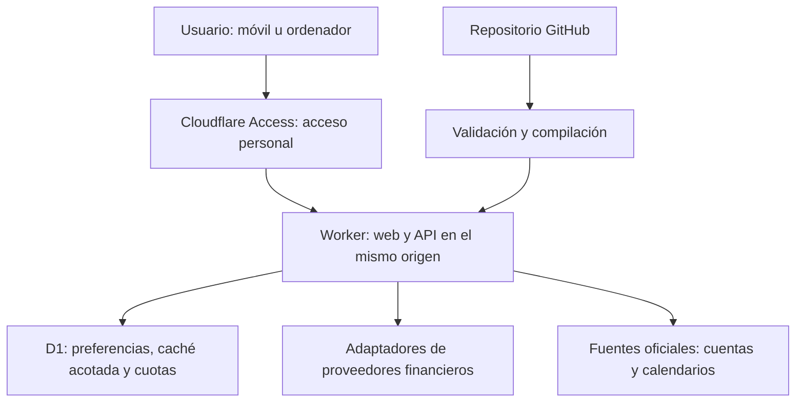
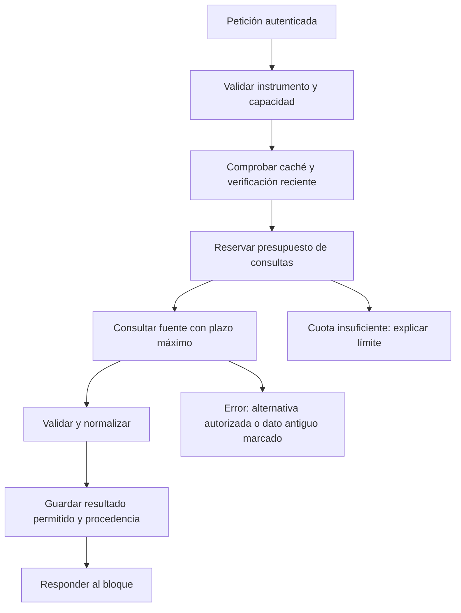

# Plan de construcción de la aplicación de análisis de empresas

**Versión:** 1.1 · **Fecha de referencia técnica:** 30 de septiembre de 2026 · **Actualización de seguimiento:** 1 de octubre de 2026 · **Idioma de la aplicación:** español.

**Objetivo:** abrir una web desde el móvil o el ordenador, escribir el nombre de una empresa cotizada y consultar la información más reciente que las fuentes disponibles permitan obtener: precio, gráficos, cuentas, métricas, noticias, competidores y próximos acontecimientos.

**Presupuesto de servicios: 0 € de alta, 0 € al mes y 0 € de consumo facturable.** El proyecto debe permanecer en productos gratuitos con límites que detengan el servicio. Los costes del ordenador, conexión a Internet y herramientas de desarrollo que el propietario ya utilice quedan fuera de este presupuesto. Ninguna API de IA de pago forma parte del funcionamiento necesario.

Este documento es el manual de ejecución para el propietario y las IA que desarrollen la aplicación. Contiene decisiones, tareas, dependencias, pruebas, criterios de cierre y mantenimiento. Una casilla indica trabajo pendiente; solo se marca al aportar evidencia.

**Para orientarte:** el [alcance](#s02) explica qué se va a construir; las [fuentes](#s05) determinan qué datos se pueden conseguir; las [fases](#s14) indican qué hacer y en qué orden; las [pruebas](#s15) permiten comprobar que funciona; el [estado de trabajo](#s17) permite retomar el proyecto en otra sesión.

**Estado real al redactar la versión 1.0:** la carpeta de trabajo estaba vacía y no era un repositorio Git. Se elaboró este plan y se contrastó documentación pública. No se crearon cuentas, contrataron servicios, obtuvieron claves, probaron proveedores con credenciales, implementó la aplicación ni desplegó nada. Las comprobaciones documentales no demuestran todavía que un proveedor sirva todos los datos necesarios.

**Continuación:** las instrucciones de trabajo están en [AGENTS.md](AGENTS.md) y el avance actual en [docs/ESTADO.md](docs/ESTADO.md). La preparación documental posterior no modifica la fecha de comprobación de las fuentes técnicas de este plan.

## Índice

1. [Cómo trabajar con este documento](#s01)
2. [Requisitos y significado de terminado](#s02)
3. [Decisiones de arquitectura](#s03)
4. [Presupuesto cero y límites](#s04)
5. [Fuentes, cobertura y prueba de viabilidad](#s05)
6. [Experiencia de uso y pantallas](#s06)
7. [Identidad de empresas e instrumentos](#s07)
8. [Contratos de datos y API](#s08)
9. [Actualización, almacenamiento y cuotas](#s09)
10. [Métricas y rigor financiero](#s10)
11. [Noticias, acontecimientos y competidores](#s11)
12. [Seguridad y acceso personal](#s12)
13. [Estructura del proyecto y entorno](#s13)
14. [Fases de ejecución F00–F20](#s14)
15. [Plan de pruebas y aceptación](#s15)
16. [Publicación, recuperación y mantenimiento](#s16)
17. [Seguimiento para el propietario y las IA](#s17)
18. [Riesgos, decisiones pendientes y alternativas](#s18)
19. [Fuentes oficiales consultadas](#s19)
20. [Registro de las tres revisiones del plan](#s20)
21. [Glosario y primer paso](#s21)

<a id="s01"></a>

## 1. Cómo trabajar con este documento

### 1.1. Orden de lectura

Al incorporarse por primera vez a la construcción, la persona o IA ejecutora debe comprender las secciones 1–5, la tabla de fases y los criterios de aceptación. Al retomar una tarea, consultará el estado, las instrucciones locales y las secciones pertinentes al cambio; no es necesario releer todo el plan antes de cada edición. Después trabajará en la primera tarea pendiente cuyas dependencias estén satisfechas, salvo que el propietario haya indicado otra prioridad.

No se debe empezar por una interfaz llena de cifras ficticias y dar por resuelta la integración. Primero se comprueba que los datos necesarios se pueden obtener legalmente, gratis, desde el entorno real y con calidad suficiente.

### 1.2. Reglas de ejecución

1. Al comenzar o retomar una tarea, leer el estado del proyecto y las instrucciones locales; consultar el detalle correspondiente al cambio.
2. Conservar trabajo previo. Investigar antes de reemplazar una implementación o reinicializar un repositorio.
3. Elegir una tarea pequeña con salida verificable y registrar que está en curso.
4. Implementar, comprobar y guardar la evidencia de esa tarea.
5. Actualizar el estado y el siguiente paso antes de terminar la sesión.
6. Mantener las claves y los datos personales fuera del repositorio y del chat.
7. Documentar cambios de decisión y su motivo. No ampliar el presupuesto, reducir la cobertura acordada ni cambiar el producto silenciosamente.
8. Distinguir siempre entre `documentado`, `probado localmente`, `probado en Cloudflare` y `probado por el propietario`.
9. No declarar completada una fase por tener código escrito: necesita superar sus criterios de salida.
10. Si una dependencia externa impide avanzar, dejar evidencia y continuar únicamente tareas independientes. No sustituir datos reales por simulados para ocultar el bloqueo.

### 1.3. Estados permitidos

| Estado | Significado |
|---|---|
| PENDIENTE | No iniciada. |
| EN CURSO | Hay trabajo activo y un responsable identificado. |
| BLOQUEADA | Falta una condición concreta: cuenta, licencia, dato, prueba o decisión. |
| EN REVISIÓN | Implementada; faltan comprobaciones o aceptación. |
| COMPLETA | Cumple todos sus criterios y enlaza evidencia. |
| NO APLICA | Exclusión justificada y compatible con los requisitos; nunca sirve para ocultar una función obligatoria. |

La creación de cuentas y aceptación de condiciones corresponde al propietario. Las IA pueden preparar los archivos, instrucciones y comprobaciones. La autorización para escribir este plan no equivale a haber autorizado compras ni a haber realizado un despliegue.

<a id="s02"></a>

## 2. Requisitos y significado de terminado

### 2.1. Requisitos del producto

| ID | Requisito | Evidencia de aceptación |
|---|---|---|
| R01 | Buscar empresas por su nombre, sin exigir un símbolo bursátil. | Búsquedas escritas en lenguaje normal, con selección si son ambiguas. |
| R02 | Búsqueda abierta: ninguna lista fija de empresas permitidas. | Buscar con éxito una empresa no usada en desarrollo y sin ficha guardada. |
| R03 | Obtener los datos más recientes accesibles al consultar. | Solicitudes reales y marcas temporales diferenciadas. |
| R04 | Precio, variación y gráfico histórico cuando la fuente los cubra. | Contraste con el mismo instrumento, sesión y fuente. |
| R05 | Noticias relevantes y enlaces a los originales. | Selección correcta de empresa, orden por fecha y eliminación de duplicados. |
| R06 | Comparación con competidores. | Comparables explicados y métricas de periodos compatibles. |
| R07 | Calendario empresarial y macroeconómico. | Fechas verificadas, zona horaria y confirmación explícita. |
| R08 | Catálogo de al menos 20 métricas adicionales al precio. | Fórmulas, procedencia, explicación y pruebas de casos límite. |
| R09 | Uso limpio e intuitivo en móvil y ordenador. | Revisión real en un móvil y pruebas de accesibilidad. |
| R10 | Fiabilidad trazable. | Fuente, fecha del dato, consulta y limitaciones por bloque. |
| R11 | Coste de servicios igual a 0 €. | Planes, configuración y comprobación de consumo sin facturación. |
| R12 | Disponibilidad sin ordenador personal encendido. | Acceso desde una red móvil con el equipo de desarrollo apagado. |
| R13 | Acceso personal protegido y claves privadas. | Intentos de acceso anónimo, de usuario ajeno y de extracción de secretos fallidos. |
| R14 | Fallos parciales comprensibles. | Una fuente caída no deja toda la ficha en blanco. |
| R15 | Mantenimiento reproducible por otra persona o IA. | Instalación limpia, documentación y procedimiento de recuperación. |

### 2.2. Lo que significa «cualquier empresa»

El buscador admite cualquier nombre y consulta catálogos externos. La aplicación no impone una selección previa de Apple, Microsoft u otras favoritas. Esto es diferente de garantizar que todos los proveedores cubran cualquier empresa del mundo.

La unidad inicial del producto son las **empresas cotizadas**. Ante una empresa privada, una marca que no cotiza o una empresa desaparecida, se muestra su situación cuando sea verificable. No se inventa una cotización. Identificar la matriz de una marca exige una relación documentada; el parecido del nombre no basta.

La cobertura se registra por **mercado, instrumento y bloque de datos**, no mediante una etiqueta global engañosa. Una empresa puede tener precio y noticias, pero carecer de dividendos confirmados o de históricos gratuitos.

### 2.3. Lo que significa «lo más actualizado posible»

Se intenta verificar la información disponible al seleccionar una empresa y al pulsar Actualizar, sujeto a los límites reales de la fuente. Se muestra la hora de la última verificación correcta. Una respuesta de caché no se presenta como una nueva consulta al proveedor.

Se distinguen cuatro cosas:

- Momento de la observación: cuándo se negoció el precio o sucedió el hecho.
- Momento de publicación: cuándo una fuente publicó la noticia o las cuentas.
- Momento de comprobación: cuándo la app obtuvo o verificó esa información.
- Retraso conocido de la fuente y alcance de su cobertura.

Las últimas cuentas publicadas pueden corresponder a un trimestre anterior y seguir siendo las más recientes. El último precio puede pertenecer al cierre de ayer porque el mercado está cerrado. Ninguna de esas situaciones autoriza a etiquetar el dato como una cotización de ahora.

### 2.4. Dos puertas de aceptación

**Puerta técnica:** todo el flujo funciona, las pruebas pasan, se mantiene el coste cero y se recupera de fallos.

**Puerta de cobertura:** el propietario conoce y acepta la cobertura demostrada en F02 y ratificada en F19. La tabla debe incluir Estados Unidos, España, otro mercado europeo y un mercado asiático, además de casos difíciles.

Si solo se logra una cobertura útil de Estados Unidos, eso es una versión parcial respecto de la aspiración global. Se puede mostrar como beta, pero no llamarla «100 % terminada» sin una decisión expresa de alcance. Marcar todos los huecos como «no disponible» tampoco satisface por sí solo el producto.

### 2.5. Condiciones mínimas para una versión útil

- Búsqueda abierta y comportamiento definido para toda consulta.
- Al menos un mercado con ficha completa demostrada y varias empresas no financieras con 20 métricas adicionales válidas; es un mínimo técnico, no una renuncia a otros mercados.
- Gráficos históricos reales, noticias, calendario y comparación funcionando en el ámbito aceptado.
- Matriz visible dentro de la app privada que explique qué se puede obtener por mercado.
- Ausencias justificadas por dato, no una mayoría de tarjetas vacías sin explicación.
- Sin bloqueos críticos de seguridad, integridad financiera, coste o autenticación.
- Manual de uso, mantenimiento y restauración comprobado.

### 2.6. Fuera de la primera versión

Ejecución de operaciones, conexión a cuentas bancarias, importación de posiciones, asesoramiento personalizado, recomendaciones automáticas de compra, predicción de precios, cobertura garantizada de reuniones privadas, alertas por correo o mensajería y servicios de IA con consumo facturable. Estos elementos no son necesarios para cumplir la aplicación de consulta descrita.

### 2.7. Checklist para declarar la entrega completa

- [ ] G-DATOS: proveedores y cobertura probados; cualquier cambio material de alcance aceptado.
- [ ] G-ACCESO: acceso personal, secretos y rutas alternativas comprobados.
- [ ] G-CIFRAS: métricas y fechas contrastadas con fuentes y cálculos de referencia.
- [ ] G-CALIDAD: pruebas obligatorias superadas y cero incidencias críticas.
- [ ] G-USUARIO: recorrido real del propietario aprobado en sus dispositivos.
- [ ] F18: producción identificada, protegida y recuperable.
- [ ] F20: documentación de operación y seguimiento inicial completados.
- [ ] Coste de servicios comprobado en 0 € y ningún producto facturable necesario.

Este resumen se marca al cerrar las fases correspondientes; no reemplaza sus evidencias. La condición «100 % funcionando» se aplica a los requisitos y cobertura aceptados, no a una garantía imposible de conocer información que ninguna fuente publique.

<a id="s03"></a>

## 3. Decisiones de arquitectura

### 3.1. Propuesta principal

**Código en GitHub. Web y API en un Cloudflare Worker con archivos estáticos. Datos operativos mínimos en D1. Acceso personal mediante Cloudflare Access.**

GitHub Pages fue una opción inicial para ahorrar alojamiento. Cloudflare también permite servir los archivos de una aplicación React y ejecutar su API en el mismo proyecto. Un único origen simplifica la sesión, el móvil, las rutas y las peticiones. La dirección gratuita será del tipo `inversiones.<subdominio>.workers.dev`; no hace falta comprar dominio. Véase la [guía oficial de React y Vite en Workers](https://developers.cloudflare.com/workers/framework-guides/web-apps/react/).

Esta arquitectura ya tiene un primer armazón publicado en staging; Access y datos reales siguen pendientes. Véase el [estado](docs/ESTADO.md). Si el propietario exige Pages, existe una variante en la sección 18; no es la ruta principal.



### 3.2. Tecnología propuesta

| Pieza | Elección | Motivo |
|---|---|---|
| Lenguaje | TypeScript con comprobación estricta. | Contratos compartidos y prevención de errores de unidades. |
| Interfaz | React + Vite. | Aplicación móvil y de escritorio en un solo código. |
| Estilos | CSS con variables y componentes propios sencillos. | Diseño controlado sin introducir una gran dependencia visual. |
| Gráficos | Recharts, previa comprobación de licencia y versión. | Líneas, barras y comparativas adaptables al tamaño disponible. |
| Servidor | Cloudflare Worker; rutas pequeñas con API web estándar. | Consultas bajo demanda y secretos fuera del navegador. |
| Validación | Un validador de esquemas, por ejemplo Zod. | No confiar en los tipos declarados de una respuesta externa. |
| Persistencia | D1 con SQL e índices, sin ORM inicialmente. | Preferencias, metadatos, caché acotada y control de consumo. |
| Acceso | Access, aplicación privada de un único usuario. | Inicio de sesión gestionado, sin construir contraseñas propias. |
| Pruebas | Vitest; integración de Workers vigente; Playwright. | Cálculos, contratos, entorno real de ejecución y uso completo. |
| Automatización | GitHub Actions para comprobaciones y publicación controlada. | La recopilación al buscar sigue ocurriendo en Workers. |

Las versiones se fijan al iniciar F03 mediante archivo de bloqueo y se registran. Node se usa para desarrollo y herramientas; el backend se ejecuta en el entorno de Workers, que no es un servidor Node convencional. No asumir acceso a disco, procesos del sistema o paquetes nativos.

### 3.3. Decisiones que evitan costes y complejidad

- Una aplicación para una persona, sin gestión de organizaciones ni pagos.
- Un único origen y una sola capa de API.
- Peticiones HTTP periódicas mientras la ficha esté visible; sin WebSockets en la primera versión.
- Cálculos deterministas, sin una IA necesaria para buscar una empresa o calcular ratios.
- Consultas bajo demanda; ningún rastreo continuo de todas las bolsas.
- Envío gradual de bloques mediante solicitudes independientes. No esperar a la fuente más lenta para mostrar todo.
- Entornos de pruebas y producción aislados, ambos bajo planes gratuitos y con cuotas compartidas contabilizadas.
- Datos privados nunca incluidos en la compilación pública ni en los archivos de GitHub.

<a id="s04"></a>

## 4. Presupuesto cero y límites

### 4.1. Registro de servicios

Crear durante F01 `docs/COSTES.md` con servicio, plan, titular, fecha de comprobación, límites, mecanismo de corte y evidencia sin secretos. Revisarlo antes de publicar y una vez al mes.

| Servicio | Configuración prevista | Regla de coste |
|---|---|---|
| GitHub | Plan gratuito y repositorio del propietario. | Controlar cuotas de Actions si el repositorio es privado; desactivar exceso facturable. |
| Workers | Workers Free, sin actualización a Paid. | El agotamiento debe producir indisponibilidad, no facturación adicional. |
| D1 | Base de datos dentro de Free. | Acotar almacenamiento y operaciones; detener escrituras si se agota. |
| Access | Plan gratuito para el acceso personal. | No contratar plazas de pago ni complementos. |
| Dominio | Subdominio `workers.dev`. | No comprar dominio. |
| Datos financieros | Cuentas gratuitas aprobadas en F02. | Excluir pruebas que pasan automáticamente a pago y complementos facturables. |
| IA en la app | Ninguna dependencia obligatoria. | Ninguna clave de modelo de pago. |
| Seguimiento técnico | Registros y métricas incluidos. | No añadir servicios externos con cobro por volumen. |

Según la documentación consultada, Workers Free permite 100.000 solicitudes diarias y 10 ms de CPU por invocación. Esperar una respuesta de red no equivale a tiempo de CPU, pero analizar JSON grande, verificar firmas y calcular sí consume CPU. Al superar la cuota diaria de solicitudes, el Worker puede responder con el error 1027. No hay que confundir estas solicitudes entrantes con llamadas a los proveedores. Fuentes: [precios](https://developers.cloudflare.com/workers/platform/pricing/) y [límites](https://developers.cloudflare.com/workers/platform/limits/).

D1 Free incluye actualmente límites diarios de lectura y escritura y límites de almacenamiento; los índices también pueden consumir escrituras. Al agotarse, las operaciones correspondientes fallan. La cuota concreta debe copiarse del panel y de la [documentación de D1](https://developers.cloudflare.com/d1/platform/pricing/) al configurar el proyecto. Access anuncia una opción gratuita para equipos pequeños, suficiente para el diseño de un usuario; comprobar la elegibilidad de la cuenta en su [página oficial](https://www.cloudflare.com/sase/products/access/).

### 4.2. No confundir gratuito con consumo gratuito ilimitado

Una cuota gratuita dentro de un producto de pago no cumple automáticamente el requisito. Cada alta debe comprobarse por separado. No añadir R2, contenedores, servicios de navegación remota, modelos de IA o planes de datos solo porque anuncien una cantidad inicial gratuita.

No se promete que el alta nunca solicite un método de pago: las condiciones y flujos pueden cambiar. Si un formulario lo exige, comprobar la modalidad exacta y resolverlo con el propietario antes de continuar. La ruta de 0 € no puede depender de aceptar cargos futuros.

### 4.3. Presupuesto operativo interno

Los siguientes valores son límites propuestos de nuestra aplicación, no promesas comerciales de los proveedores:

- Mantener una ficha activa por pestaña y limitar el número de pestañas que refrescan.
- Máximo inicial de 3 competidores en comparación automática; ampliar solo a petición del usuario.
- Cotización: refresco nominal cada 60 segundos, solo con ficha visible, conexión y mercado abierto confirmado.
- Noticias: comprobación inicial y posteriormente cada 5 minutos mientras se visualicen.
- Máximo inicial de 3 solicitudes simultáneas a proveedores; además, límite específico por proveedor.
- Agotar como máximo el 70 % de la cuota contractual en la configuración normal, reservando margen para errores, pruebas y uso manual.
- Guardar como caché solo resultados de empresas consultadas; objetivo inicial menor de 100 MB por entorno, medido y purgado.
- Cortar reintentos y actualizaciones automáticas antes de agotar el presupuesto conocido.

**Puerta de coste:** ninguna fase de publicación se cierra con un servicio cuyo mecanismo de cobro o exceso de cuota sea desconocido. Los límites internos reducen uso, pero no sustituyen mantener el plan gratuito del proveedor.

<a id="s05"></a>

## 5. Fuentes, cobertura y prueba de viabilidad

### 5.1. Orden de confianza

Para cuentas y fechas empresariales: regulador o publicación oficial de la empresa. Para cotizaciones: proveedor con cobertura e identificación del mercado verificadas. Para noticias: originales enlazados y medios identificados. Para cálculos: fórmula reproducible con los datos de entrada y su procedencia.

La reputación de una fuente no justifica mezclar instrumentos o presentar una estimación como hecho. No se asignan porcentajes arbitrarios de fiabilidad. Se usan estados descriptivos: oficial, proveedor, cálculo propio, estimado, sin verificar o discrepante.

### 5.2. Proveedores candidatos, no integraciones ya comprobadas

| Fuente | Uso propuesto | Condición antes de activarla |
|---|---|---|
| OpenFIGI | Identidad de instrumentos por nombre/identificadores; no cotizaciones. | Resolver alias de emisor, bolsa y clase; su [prueba local](docs/evidencias/F02_IDENTIDAD_OPENFIGI.md) no resolvió «Inditex» como acción ordinaria. |
| Finnhub | Búsqueda, perfil, precio y algunos bloques empresariales. | Probar cada endpoint con la cuenta gratuita real y cada mercado. Una página de documentación no demuestra derecho de acceso. |
| SEC/EDGAR | Presentaciones e información financiera de emisores que reportan en EE. UU. | Cumplir acceso automatizado; validar CIK, periodos y etiquetas contables. |
| Alpaca Basic | Candidato para precios e históricos de acciones estadounidenses. | Comprobar acceso personal gratuito, feed solicitado y limitación temporal. |
| Web de relaciones con inversores | Comunicados, dividendos y eventos. | Verificar dominio y una interfaz accesible permitida: RSS, ICS, HTML estructurado o publicación oficial. |
| Reserva Federal, BLS, BCE | Calendarios macroeconómicos. | Adaptador específico, fuente oficial, zona horaria y prueba del formato actual. |
| CNMV y fuentes de otros países | Información publicada para mercados adicionales. | Investigación y prueba explícitas; no asumir una API homogénea ni que exista acceso directo desde Workers. |
| Proveedor adicional gratuito | Cubrir huecos demostrados. | Misma auditoría de precio, licencia, frescura, unidades y funcionamiento; no se aprueba por una recomendación de un blog. |

Finnhub documenta búsqueda por nombre, noticias de empresas norteamericanas y varios endpoints financieros. Sus condiciones personales prohíben compartir datos o resultados derivados con terceros sin autorización. La aplicación quedará protegida para el propietario mientras utilice esas condiciones. Referencias: [API](https://finnhub.io/docs/api/quote) y [condiciones](https://finnhub.io/terms-of-service).

Alpaca distingue su cobertura gratuita en directo de IEX de la cobertura consolidada de todas las bolsas estadounidenses. No se deben mezclar el volumen de IEX y un precio consolidado como si provinieran del mismo mercado. La disponibilidad del histórico reciente depende del feed y plan: debe probarse expresamente. [Documentación de Alpaca](https://docs.alpaca.markets/us/docs/about-market-data-api).

### 5.3. Candidatos que no se presuponen válidos

- **Twelve Data:** su plan Basic consultado describe uso interno sin visualización. No convertirlo en proveedor de un panel visual sin confirmar que las condiciones permitan esa presentación. Sus mercados y derechos cambian según plan. [Precios oficiales](https://twelvedata.com/pricing).
- **Alpha Vantage:** el acceso gratuito estándar consultado tiene 25 solicitudes al día; los precios estadounidenses en directo y con 15 minutos de retraso requieren acceso premium. Puede servir para una tarea acotada, pero no se adopta como base de consultas frecuentes. [Condiciones oficiales](https://www.alphavantage.co/support/).
- **Yahoo Finance y bibliotecas no oficiales:** no constituyen una garantía de API, licencia, disponibilidad ni frescura. No serán una dependencia imprescindible de producción. Una evaluación futura requiere condiciones y pruebas propias.
- **Páginas que exigen CAPTCHA, sesión de pago o elusión de controles:** quedan fuera de los adaptadores automáticos. Se puede mostrar un enlace legítimo al original.
- **Datos de demostración:** sirven para probar componentes, no para acreditar cobertura de una empresa real.

### 5.4. Matriz obligatoria de capacidades

Crear `docs/COBERTURA.md` y una configuración legible por máquina, por ejemplo `config/providers.json`. Cada fila tendrá:

```text
proveedor, plan, fecha de validación, país, bolsa/MIC, tipo de instrumento,
capacidad, endpoint, acceso desde local, acceso desde Worker,
derecho de visualización personal, redistribución, retención autorizada,
cuota y peso por consulta, divisa, unidad, feed, retraso documentado,
marca temporal observada, profundidad histórica, resultado, evidencia
```

Capacidades separadas: búsqueda, perfil, precio, histórico, operaciones corporativas, cuentas, métricas, noticias, resultados, dividendos, otros eventos y comparables. Un endpoint puede existir y devolver 403 en el plan gratuito. Eso se registra como no disponible, no como un error que haya que reintentar indefinidamente.

Estados de validación: `PENDIENTE`, `DOCUMENTADO`, `PROBADO`, `NO_CUBIERTO`, `ACCESO_DENEGADO`, `LICENCIA_INSUFICIENTE` y `FALLO_TEMPORAL`.

### 5.5. Muestra de pruebas

Esta muestra es para validación; nunca se convierte en una lista de empresas permitidas por la app:

| Caso | Qué verifica |
|---|---|
| Apple y Microsoft | Ficha completa de grandes empresas estadounidenses. |
| Alphabet | Diferentes clases de acciones de un mismo emisor. |
| Berkshire Hathaway | Símbolos con puntuación, clases y actividad particular. |
| Inditex y Santander | Mercado español y diferencias de métricas bancarias. |
| ASML | Cotización europea frente a una cotización estadounidense. |
| Toyota | Mercado japonés, divisa y eventual certificado estadounidense. |
| Una empresa pequeña elegida el día de la prueba | Cobertura fuera de los ejemplos habituales. |
| Una empresa recién cotizada elegida al probar | Historial insuficiente y cuentas parciales. |
| Una empresa suspendida o excluida elegida al probar | Estado del instrumento y último precio antiguo. |
| «3M», nombre con tildes y nombre abreviado | Búsqueda de dos caracteres y normalización. |
| Empresa privada, marca y nombre inexistente | Respuestas honestas sin sustituciones inventadas. |

Para cada caso: guardar nombre consultado, instrumento seleccionado, hora UTC, mercado, capacidades probadas, respuesta saneada cuando su conservación esté permitida y conclusión. No publicar respuestas comerciales reales en un repositorio público. Las pruebas automáticas usarán datos sintéticos o conjuntos cuya redistribución esté permitida.

### 5.6. Prueba mínima antes de desarrollar toda la interfaz

1. Crear las cuentas gratuitas estrictamente necesarias.
2. Probar nombre → instrumento → precio con una empresa conocida y otra nueva.
3. Probar histórico real; no asumir que el endpoint de velas sea gratuito.
4. Probar cuentas y suficientes entradas para al menos 20 métricas.
5. Probar noticias, un evento confirmado y comparables.
6. Repetir los accesos desde un Worker protegido. Un éxito en el portátil no demuestra que la IP de Cloudflare tenga acceso.
7. Medir CPU, tamaño y latencia de la respuesta más pesada.
8. Repetir en varios países y registrar todos los huecos.
9. Confirmar derechos de visualización personal, almacenamiento y eliminación.
10. Decidir si la cobertura cumple el alcance. Si no, investigar otra fuente gratuita o mantener bloqueada la promesa correspondiente.

**Decisión G-DATOS:** un informe breve identifica proveedores primarios y alternativos por capacidad, cobertura conseguida, restricciones y pruebas pendientes. El propietario ratifica cualquier reducción material respecto de su objetivo global. Las tareas de documentación o estructura pueden avanzar mientras tanto, pero no se declara viable una cobertura que no se ha demostrado.

<a id="s06"></a>

## 6. Experiencia de uso y pantallas

### 6.1. Recorrido principal

Abrir enlace → iniciar sesión personal → escribir un nombre → seleccionar la empresa y bolsa si hace falta → ver resumen → consultar gráficos, métricas, noticias, eventos o competidores → actualizar o guardar en favoritas.

El nombre de la empresa es el elemento principal. Símbolo, mercado y divisa aparecen como información secundaria para evitar equivocaciones. El usuario no tiene que conocerlos de antemano.

### 6.2. Pantallas

| Pantalla | Contenido y acciones |
|---|---|
| Inicio | Buscador grande, favoritas, búsquedas recientes y acceso a cobertura. |
| Resultados | Nombre, país, bolsa, divisa, tipo de instrumento y estado. Navegable con teclado. |
| Ficha | Cabecera, precio, gráfico, resumen financiero y acceso claro a cada bloque. |
| Métricas | Grupos de crecimiento, rentabilidad, solvencia, valoración y dividendos; definiciones desplegables. |
| Noticias | Fecha, medio, titular, relación con la empresa y enlace. |
| Calendario | Próximos 7/30/90 días; eventos empresariales y contexto macro distinguidos. |
| Competidores | Hasta tres comparables inicialmente; selección editable y comparación comprensible. |
| Fuentes y cobertura | Estado por bloque, origen, frescura, incidentes y límites conocidos. |
| Preferencias | Zona horaria, tema, gestión de favoritas, exportación/importación de preferencias y cierre de sesión. |

### 6.3. Diseño móvil

- Diseño desde 320 px de ancho; sin desplazamiento horizontal accidental de toda la página.
- Objetivos táctiles de al menos 44 × 44 px como criterio de diseño del proyecto.
- Buscador accesible y teclado que no tape el resultado seleccionado.
- Tipografía legible, contraste suficiente y cifras alineadas.
- Color acompañado de signo, etiqueta o icono; no depender solo de rojo y verde.
- Gráficos con controles táctiles, resumen textual y alternativa tabular.
- Tablas comparativas que puedan desplazarse dentro de su contenedor o convertirse en tarjetas.
- Animaciones discretas y respeto por reducción de movimiento.
- Español y formato `es-ES`; divisa del instrumento explícita, nunca convertida en euros sin indicar tipo y fecha de cambio.

### 6.4. Estados de cada bloque

`Inicial`, `Cargando`, `Disponible`, `Sin resultados`, `No cubierto`, `No aplicable`, `Desactualizado`, `Error temporal`, `Cuota agotada` y `Sesión caducada`.

Ejemplos de mensajes correctos:

- «Precio de las 16:29, hora de Nueva York. Consultado hace 20 segundos».
- «Últimas cuentas publicadas: trimestre terminado el…».
- «No hemos encontrado eventos confirmados en las fuentes consultadas».
- «El proveedor no incluye este histórico en el plan gratuito».
- «No se ha podido actualizar. Se muestra el dato guardado de…».

No mostrar «sin dividendos» cuando simplemente falte cobertura. No mostrar «actualizado» porque haya terminado una animación.

<a id="s07"></a>

## 7. Identidad de empresas e instrumentos

### 7.1. Separar emisor y cotización

Una empresa puede tener varias clases, varias bolsas y certificados de depósito. El modelo distingue:

- `Company`: entidad empresarial, nombre legal, alias verificados, país, sector, web oficial e identificadores regulatorios.
- `Listing`: instrumento concreto, empresa asociada, símbolo del proveedor, bolsa/MIC, divisa, tipo, clase, estado y zona horaria.
- `ProviderMapping`: relación entre el identificador interno y el identificador que requiere cada fuente.

El identificador interno será estable y no dependerá únicamente de un símbolo. No identificar una compañía solo por un nombre normalizado. CIK identifica al emisor que presenta documentos ante la SEC, no a todas sus cotizaciones individuales.

### 7.2. Resolución de nombres

1. Normalizar espacios y Unicode sin perder el texto original.
2. Admitir consultas de 2–80 caracteres, incluidos nombres como 3M.
3. Esperar unos 350 ms después de escribir para evitar una llamada por tecla.
4. Consultar el catálogo habilitado; combinar resultados solo si la identidad se puede verificar.
5. Ordenar por coincidencia de nombre, alias verificados y disponibilidad; no por una predicción inventada de intención.
6. Presentar opciones cuando haya múltiples bolsas, clases o empresas homónimas.
7. Guardar la selección y el mapeo para esa sesión y para futuras consultas.
8. Cancelar solicitudes anteriores al cambiar la búsqueda; impedir que una respuesta tardía sustituya la selección actual.

Un ADR no se sustituye silenciosamente por la acción original. Si se ofrece como alternativa por cobertura, explicar divisa, mercado y relación conocida; pedir al usuario que lo seleccione.

<a id="s08"></a>

## 8. Contratos de datos y API

### 8.1. Esquema común

Todos los bloques deben validar sus entradas y respuestas en tiempo de ejecución. El contrato se implementará y documentará en `shared/` y `docs/API.md`. Ejemplo de diseño, no código ya instalado:

```typescript
type DataStatus =
  | 'available' | 'partial' | 'unavailable' | 'not_applicable'
  | 'stale' | 'rate_limited' | 'error';

interface Provenance {
  provider: string;
  sourceUrl: string | null;       // Página consultable, nunca URL con token.
  retrievedAt: string;           // UTC ISO: se descargó el contenido.
  checkedAt: string;             // Última validación correcta con la fuente.
  observedAt: string | null;     // Hora del hecho o cotización.
  publishedAt: string | null;    // Publicación del documento o noticia.
  periodStart: string | null;    // YYYY-MM-DD para datos contables.
  periodEnd: string | null;
  delaySeconds: number | null;   // null significa desconocido.
  feed: string | null;
  methodologyVersion: string;
}

interface DataBlock<T> {
  status: DataStatus;
  data: T | null;
  provenance: Provenance[];
  servedAt: string;              // Hora de respuesta de nuestra API.
  fromCache: boolean;
  cacheAgeSeconds: number | null;
  nextAllowedRefreshAt: string | null;
  warnings: string[];
  reasonCode: string | null;
  requestId: string;
}
```

Las métricas necesitan procedencia por valor si combinan fuentes distintas. El `checkedAt` agregado de una tarjeta no reemplaza las fechas de sus componentes. Un valor cero válido se conserva como cero; un dato ausente es `null` con motivo. Prohibido convertir cadenas vacías, errores o `NaN` en ceros.

Elegir y documentar precisión numérica. Mantener importes originales como decimal exacto o cadena validada cuando superen la precisión segura de `number`; usar una biblioteca decimal compatible o una conversión controlada para los cálculos que lo requieran. No serializar `BigInt` directamente a JSON. Probar escalas grandes y redondeos por separado del formato visual.

### 8.2. Modelos adicionales

| Modelo | Campos que no pueden faltar |
|---|---|
| Quote | Listing, precio, moneda, unidad, observación, sesión, feed y cobertura. |
| PriceBar | Inicio/fin, resolución, OHLC o cierre, volumen si existe, ajuste aplicado y fuente. |
| FinancialFact | Concepto normalizado, valor, unidad, escala, periodo, fecha de presentación y documento. |
| Metric | ID, valor, unidad, fórmula/versión, entradas, periodo, estado y explicación. |
| NewsItem | ID, titular, URL, fuente, publicación, empresas relacionadas y motivo de relación. |
| Event | Tipo, empresa o región, listing cuando corresponda, fecha/hora, precisión, zona, estado y fuente. |
| Peer | Empresa/listing, origen de la selección, motivo y fecha de comprobación. |
| Capability | Fuente, mercado, bloque, plan, licencia, límites y fecha de prueba. |
| Preference | Propietario interno, preferencias y versión para controlar escrituras concurrentes. |

Los precios en peniques y libras, por ejemplo, no comparten escala aunque pertenezcan a un mismo entorno monetario. La moneda y unidad se validan antes de calcular ratios.

### 8.3. Rutas propuestas

Prefijo `/api/v1`. Todas las rutas de datos requieren autenticación. Los identificadores de ruta se codifican y validan; el cliente no puede enviar una URL arbitraria de proveedor.

| Método y ruta | Función |
|---|---|
| `GET /health` | Estado mínimo de la aplicación, sin consultar proveedores ni revelar secretos. |
| `GET /capabilities` | Cobertura y capacidades habilitadas. |
| `GET /search?q=...` | Resolver nombres a candidatos. |
| `GET /listings/:id/profile` | Identidad, descripción y enlaces oficiales. |
| `GET /listings/:id/quote` | Última cotización accesible. |
| `GET /listings/:id/prices?range=1y` | Serie histórica con ajuste y resolución documentados. |
| `GET /companies/:id/financials` | Cuentas normalizadas y documentos. |
| `GET /listings/:id/metrics` | Métricas que combinan emisor e instrumento correctamente. |
| `GET /companies/:id/news` | Noticias con paginación acotada. |
| `GET /companies/:id/events?listingId=...` | Eventos empresariales; dividendos y splits filtrados por el instrumento seleccionado. |
| `GET /macro?regions=US,EU` | Calendario macro filtrado y limitado. |
| `GET /companies/:id/peers` | Comparables y su justificación. |
| `GET /preferences` | Preferencias y favoritas del propietario. |
| `PUT /preferences` | Guardado con versión, validación de origen y tamaño. |
| `POST /refresh` | Verificación de un bloque para una empresa o instrumento validado. |

`POST /refresh` recibirá exactamente un bloque y su identidad: `{ "block": "quote", "listingId": "ID_INTERNO" }`, o el identificador de empresa/región que requiera un bloque permitido. Un esquema discriminado rechazará combinaciones incompatibles. El frontend dividirá Actualizar en peticiones por bloque, con concurrencia limitada y resultados progresivos. Cada respuesta devuelve directamente el `DataBlock` actualizado; no exige repetir un GET que cause otra consulta. Se reutiliza la misma lógica que en la lectura inicial, solicitando una verificación nueva dentro de cuotas y de la ventana de agrupación de 10 segundos. No inicia trabajos indefinidos ni depende de un cron futuro.

Configurar el enrutado de archivos estáticos para que `/api/*` pase por el Worker, por ejemplo mediante `assets.run_worker_first` cuando corresponda a la versión usada. Toda ruta API desconocida debe devolver un 404 JSON, nunca el HTML de la aplicación por el fallback de la SPA. Validar este comportamiento en la compilación desplegada.

### 8.4. Errores

Usar 400 para parámetros inválidos, 401/403 para acceso, 404 para identidad inexistente, 429 para límites propios y 502/503 para fallos globales de dependencia. Un bloque sin cobertura conocida puede devolver 200 con `status: unavailable` y motivo explícito: no es un fallo del servidor.

Respuestas de error: código estable, mensaje seguro, `requestId`, fecha y posibilidad de reintentar. No devolver el cuerpo crudo de un proveedor cuando contenga credenciales, HTML de errores o información privada.

### 8.5. Compatibilidad

Versionar contrato y metodología. Los cambios aditivos son preferibles. Un cambio incompatible exige nueva versión o actualización coordinada de frontend y backend. La aplicación reconocerá una versión de API incompatible y propondrá recargar, sin entrar en un bucle.

<a id="s09"></a>

## 9. Actualización, almacenamiento y cuotas

### 9.1. Política de actualización por bloque

Estos tiempos son decisiones iniciales de producto, ajustables tras medir; no garantizan la frescura del proveedor.

| Bloque | Al seleccionar o actualizar | Reutilización y actividad posterior |
|---|---|---|
| Identidad | Resolver contra catálogo; actualizar un mapeo ausente o sospechoso. | Catálogo/mapeos hasta 24 h; invalidar cambios de símbolo conocidos. |
| Precio | Consultar la fuente salvo solicitudes idénticas agrupadas durante 10 s. | Refresco nominal de 60 s con página visible; indicar toda reutilización. |
| Histórico | Obtener periodo solicitado y verificar la parte reciente. | Reutilizar tramos cerrados; invalidar por correcciones y operaciones corporativas. |
| Noticias | Consultar novedades en la búsqueda y actualización explícita. | Refresco automático cada 5 min si el bloque está abierto. |
| Cuentas | Comprobar nuevas publicaciones; descargar y recalcular si han cambiado. | Reutilizar documentos identificados por versión; conservar la última comprobación. |
| Eventos | Comprobar la fuente al solicitar el bloque. | Refresco automático a los 15 min; fechas sujetas a cambios. |
| Macro | Verificar calendario cuando se solicite. | Ventana automática de 1 h; actualización manual dentro de cuotas. |
| Comparables | Comprobar la selección cuando venza su vigencia o se pida actualizar. | Relación de comparables hasta 7 días; sus precios siguen la política de precio. |

Si una fuente no proporciona un mecanismo ligero para detectar novedades, su comprobación puede requerir una petición completa. El coste se cuenta. No decir que se ha verificado un documento solo porque no haya vencido una caché local.

### 9.2. Flujo de una consulta



Una caché que cumpla la política puede responder directamente antes de reservar presupuesto. El diagrama representa el camino que necesita una nueva consulta; no implica consultar siempre después de cada acierto de caché.

### 9.3. D1: tablas mínimas

| Tabla | Uso e índices previstos |
|---|---|
| `companies` | Identidad estable; índices por identificadores regulatorios verificados. |
| `listings` | Instrumento y mercado; unicidad de la combinación canónica. |
| `provider_mappings` | Claves externas; unicidad por proveedor e instrumento. |
| `cache_entries` | Clave, JSON normalizado acotado, procedencia, caducidad, versión; índice de caducidad. |
| `provider_budgets` | Estado de cuota por proveedor y ámbito; actualizaciones atómicas. |
| `refresh_leases` | Bloqueo corto con vencimiento para evitar consultas duplicadas. |
| `preferences` | Favoritas y ajustes del único propietario, con número de versión. |
| `provider_status` | Último fallo, circuito temporal y versión de capacidad validada. |

No guardar artículos completos, PDFs o históricos de todas las empresas por defecto. Cada respuesta almacenada tendrá tamaño máximo y política de eliminación. Las claves de caché incluyen proveedor, listing, moneda, feed, resolución, ajuste, periodo y versión de metodología cuando corresponda.

### 9.4. Concurrencia y agotamiento

- El limitador debe reservar cuota de forma atómica en D1; una variable de memoria del Worker no coordina distintas instancias.
- Implementar un algoritmo documentado, por ejemplo un depósito de tokens con actualización atómica, compatible con los límites por segundo, minuto y día que se hayan verificado.
- Probar peticiones simultáneas y cambios de minuto. Un contador ingenuo puede duplicar el límite en la frontera entre ventanas.
- Contar intentos, alternativas y reintentos, no solo respuestas correctas.
- Si D1 no permite comprobar el presupuesto, detener nuevas llamadas externas y explicar el fallo. No continuar sin control.
- Un bloqueo de actualización debe caducar y pertenecer a una petición concreta; liberar solo el bloqueo adquirido.
- Ante 429 del proveedor, respetar `Retry-After` cuando exista, detener el refresco y mostrar cuándo se podrá volver a intentar.
- No repartir llamadas entre cuentas o direcciones para eludir una cuota.

**Cuotas compartidas entre entornos:** identificar si el límite pertenece a la clave, cuenta, endpoint o familia de datos. Staging y producción tienen bases distintas, pero pueden consumir una misma cuota externa. En ese caso se asignan particiones cuya suma no supere el presupuesto total: propuesta inicial, 50 % del límite para producción, 15 % para staging, 5 % para pruebas manuales y 30 % de reserva. Redondear hacia abajo y adaptarlo si el límite es pequeño. Las pruebas locales reales deben usar su partición o pasar por el servicio protegido de pruebas; no quedan fuera del cómputo. Cambiar particiones requiere actualizar ambos entornos de forma segura, reduciendo antes de aumentar.

El mismo criterio se aplica a cuotas de Cloudflare compartidas por cuenta. No tratar cada base o Worker como si recibiera una cuota adicional independiente. Las pruebas de carga usan simulaciones y no intentan agotar de verdad la cuenta.

### 9.5. Plazos, reintentos y alternativas

Objetivo inicial: 8 segundos de espera por fuente, máximo un reintento para fallos transitorios y máximo una fuente alternativa por capacidad. Aplicar presupuesto de tiempo total de bloque de 20 segundos. Una fuente alternativa solo es elegible si corresponde al mismo instrumento, derechos, moneda, periodo y calidad comparable.

El plazo total tiene prioridad: cada intento recibe como máximo el tiempo restante y se cancela al vencer. No encadenar tres esperas completas de 8 segundos y anunciar un máximo de 20. Al abandonar la ficha se cancelan tareas que ya no hacen falta; una llamada ya iniciada sigue consumiendo presupuesto aunque su respuesta se descarte.

No reintentar automáticamente 400, 401, 403 ni un error de esquema persistente. Un 404 requiere comprobar identidad o capacidad. Abrir temporalmente el circuito de una fuente con fallos repetidos y permitir una prueba de recuperación controlada.

Para datos antiguos tras un fallo, aplicar una política específica: precios conservan la hora original y no se usan para una valoración presentada como actual; cuentas siguen identificadas por periodo y última verificación; noticias y eventos guardados indican que no se ha comprobado si hubo novedades o cancelaciones. Los ratios derivados heredan la advertencia de cualquier entrada antigua. El máximo de retención es el menor entre la política de la app y lo autorizado por la fuente.

### 9.6. CPU, documentos grandes y SEC

La API de la SEC no requiere clave para los recursos descritos, publica datos XBRL y no admite acceso CORS directo desde cualquier web. El Worker actúa como servidor de consulta. Su [documentación](https://www.sec.gov/search-filings/edgar-application-programming-interfaces) explica los recursos por empresa y concepto; las [normas de acceso automatizado](https://www.sec.gov/about/developer-resources) deben aplicarse con identificación y ritmo adecuados.

Antes de adoptar `companyfacts` completo, medir archivos grandes desde el entorno gratuito con autenticación y validación activas. La aplicación no puede depender de analizar un JSON enorme dentro de 10 ms de CPU.

Orden de solución si una respuesta resulta demasiado pesada:

1. Solicitar solo conceptos necesarios o endpoints más pequeños, dentro de cuotas.
2. Separar bloques y paginar periodos; cachear únicamente datos normalizados permitidos.
3. Usar un proveedor normalizado gratuito previamente aprobado para ese campo y mantener el enlace a la publicación oficial.
4. Si la transformación sigue sin caber, documentar una alternativa de procesamiento en el navegador en un Web Worker y validar tamaño, rendimiento móvil y procedencia. No aceptar resultados enviados por el cliente como datos oficiales persistentes.
5. Si ninguna alternativa gratuita supera la prueba, mantener esa capacidad bloqueada. No subir de plan automáticamente.

Si la SEC bloquea solicitudes desde una infraestructura concreta, registrar el resultado y usar una alternativa autorizada. No diseñar evasión de restricciones por IP.

<a id="s10"></a>

## 10. Métricas y rigor financiero

### 10.1. Convenciones

El catálogo siguiente define más de 20 métricas adicionales al precio. Algunas no son aplicables a bancos, aseguradoras, empresas sin beneficios o determinadas estructuras de capital. La interfaz debe explicarlo y evitar un ranking universal.

`TTM` significa últimos doce meses reportados, calculados a partir de cuatro trimestres no solapados cuando existan. Los balances son datos en una fecha; ingresos y flujos abarcan un periodo. Las cuentas oficiales y su interpretación básica se describen en la [guía de estados financieros de la SEC](https://www.sec.gov/about/reports-publications/investorpubsbegfinstmtguide). Las convenciones operativas de esta aplicación se detallan aquí y se versionarán.

### 10.2. Catálogo inicial

| ID | Métrica | Definición de la aplicación | Precaución |
|---|---|---|---|
| M01 | Variación de la sesión | `(precio / cierre anterior compatible − 1) × 100`. | Misma moneda, instrumento y criterio de ajuste. |
| M02 | Rentabilidad de precio a 1 año | `(cierre ajustado final / inicial − 1) × 100`. | Usar fechas de negociación y ajuste de splits; no llamarla rentabilidad total. |
| M03 | Capitalización | Dato fiable del emisor o suma adecuada por clases. | No multiplicar acciones diluidas medias por precio como si fueran acciones actuales. |
| M04 | Volumen de la sesión | Volumen publicado por el feed. | Identificar bolsa parcial o mercado consolidado. |
| M05 | Máximo de 52 semanas | Máximo diario según histórico y ajuste documentados. | Requiere profundidad suficiente. |
| M06 | Mínimo de 52 semanas | Mínimo diario con la misma convención. | No completar un año con semanas inexistentes. |
| M07 | Ingresos TTM | Suma de ingresos de cuatro trimestres compatibles. | No sumar importes acumulados anuales. |
| M08 | Crecimiento de ingresos | `TTM actual / TTM anterior − 1`. | Base anterior positiva; si no, explicación y valor no significativo. |
| M09 | Beneficio neto TTM | Suma de beneficios atribuibles compatibles. | Indicar atribución a matriz/comunes y criterio contable. |
| M10 | Crecimiento del beneficio | Variación entre TTM comparables. | Si la base es cero o negativa, mostrar cambio absoluto y evitar porcentaje engañoso. |
| M11 | Beneficio por acción diluido | EPS diluido TTM publicado o derivado con política validada. | Splits y cambios de acciones pueden invalidar sumar EPS sin ajustar. |
| M12 | Margen bruto | `beneficio bruto TTM / ingresos TTM`. | No universal para entidades financieras. |
| M13 | Margen operativo | `resultado operativo TTM / ingresos TTM`. | No confundir EBITDA con resultado operativo. |
| M14 | Margen neto | `beneficio neto TTM / ingresos TTM`. | Periodos y atribución compatibles. |
| M15 | Caja y equivalentes | Último balance publicado. | Separar inversiones a corto plazo cuando no se incluyan. |
| M16 | Deuda financiera bruta | Deuda financiera corriente + no corriente, sin duplicar porciones. | Declarar tratamiento de arrendamientos; no sustituir por pasivo total. |
| M17 | Deuda neta | `deuda financiera bruta − caja y equivalentes`. | Permitir valor negativo y explicar la convención. |
| M18 | Patrimonio neto | Último balance, atribución documentada. | Puede ser negativo. |
| M19 | Flujo de caja operativo TTM | Suma de flujos operativos de cuatro trimestres derivados correctamente. | Los estados trimestrales suelen acumular meses. |
| M20 | Inversión en activos fijos TTM | Salidas por activos fijos según definición elegida. | Normalizar signo; no usar adquisiciones empresariales como sustituto. |
| M21 | Flujo de caja libre TTM | `flujo operativo − inversión en activos fijos`. | Medida propia, no necesariamente la cifra ajustada de la empresa. |
| M22 | Margen de caja libre | `flujo de caja libre TTM / ingresos TTM`. | Conservar valores negativos. |
| M23 | PER histórico | `precio / EPS diluido TTM compatible`. | No significativo si EPS ≤ 0; misma base por acción y moneda. |
| M24 | Precio/ventas | `capitalización / ingresos TTM`. | Monedas, entidad y fechas identificadas. |
| M25 | Precio/valor contable | `capitalización / patrimonio atribuible compatible`. | No significativo con patrimonio ≤ 0. |
| M26 | Rentabilidad de caja libre | `flujo de caja libre TTM / capitalización`. | Definición y fecha de capitalización visibles. |
| M27 | ROE | `beneficio atribuible TTM / patrimonio medio compatible`. | Media inicio/fin; no significativo con base inadecuada o negativa. |
| M28 | Ratio corriente | `activo corriente / pasivo corriente`. | No aplicable a todas las entidades; división por cero controlada. |
| M29 | Deuda/patrimonio | `deuda financiera / patrimonio compatible`. | No significativo con patrimonio ≤ 0. |
| M30 | Dividendo por acción de 12 meses | Suma de dividendos del instrumento en ventana definida. | Ajustar splits; separar especiales, ordinarios y moneda. |
| M31 | Rentabilidad por dividendo histórica | `dividendo por acción 12 meses / precio`. | No es una promesa de dividendo futuro. |
| M32 | Porcentaje de reparto | `dividendos comunes / beneficio atribuible a comunes`, mismo periodo. | Si beneficio ≤ 0, no significativo. |

### 10.3. Reglas contables obligatorias

1. Conservar unidades originales, escala y moneda; normalizar una sola vez.
2. Identificar US GAAP, IFRS o medidas ajustadas. No mezclarlas sin una nota explícita.
3. Guardar documento y fecha de presentación, no solo el año fiscal.
4. Diferenciar trimestre, acumulado de seis/nueve meses y año completo.
5. Derivar Q2 como acumulado de seis meses menos Q1; Q3 como nueve meses menos seis; Q4 como año menos nueve, únicamente para flujos aditivos compatibles.
6. No aplicar esa resta a balances, ratios, EPS o promedios de acciones sin una metodología específica.
7. Tratar años de 52/53 semanas y ejercicios que no terminan en diciembre.
8. Cuando se publique una corrección, seleccionar la versión más reciente para el mismo periodo y mantener trazabilidad.
9. No usar datos futuros en un cálculo histórico. Para la ficha actual se usa la última información publicada disponible.
10. Definir un catálogo de etiquetas XBRL equivalentes y sus prioridades. No escoger una etiqueta solo por contener palabras parecidas.
11. No sumar totales y sus componentes a la vez.
12. No rellenar conceptos inexistentes mediante una respuesta generada por IA.
13. Evitar conversiones de moneda en la primera versión. Si un ratio exige conversión no disponible y fechada, mostrar no calculable.
14. No comparar métricas de ejercicios distintos como si representaran el mismo periodo; presentar las fechas.

### 10.4. Pruebas de referencia

Crear ejemplos sintéticos revisados manualmente: ingresos anuales y acumulados, caja libre negativa, beneficio cero, patrimonio negativo, cambio de moneda, split, ADR, clases de acciones, corrección de cuentas, año fiscal distinto y falta de un trimestre.

Para al menos tres empresas reales del alcance aceptado, contrastar manualmente cinco métricas con sus documentos, conservando cálculos y referencias permitidas. Las tolerancias dependerán de la unidad y redondeo; no aceptar diferencias grandes con una tolerancia porcentual universal.

Cada métrica mostrará una explicación breve, fórmula, fecha de inputs y motivo si no puede calcularse. Los números redondeados de la interfaz no se reutilizan para cálculos internos.

<a id="s11"></a>

## 11. Noticias, acontecimientos y competidores

### 11.1. Noticias

Combinar noticias asociadas a la empresa por un proveedor y comunicados oficiales. Mantener URL canónica, fuente, hora publicada, idioma y relación con la empresa. Eliminar duplicados por URL y semejanza de titular, conservando cobertura de medios diferentes cuando aporte información distinta.

Clasificar como noticia de la empresa, competidor, sector o contexto macro. La relación indirecta debe explicar la regla aplicada; no convertir una coincidencia de palabras en un hecho relevante. «Apple» como fruta es una prueba negativa obligatoria.

Mostrar titulares y fragmentos autorizados; no descargar y republicar artículos completos. Una noticia antigua descubierta hoy conserva su fecha original. Los textos externos se tratan como datos, nunca como instrucciones para la aplicación o una IA.

No se incluye una puntuación opaca de sentimiento. Una futura explicación generada requerirá fuentes, evaluación y presupuesto propios; el producto básico funciona sin ella.

### 11.2. Eventos empresariales

Tipos: resultados, junta de accionistas, día del inversor, presentación pública, hito de proyecto anunciado, dividendo, split y otros eventos verificables.

Para dividendos separar anuncio, fecha exdividendo, fecha de registro y pago. No calcular una a partir de otra sin una regla bursátil vigente y validada. Registrar dividendos especiales, cancelaciones y modificaciones.

Un proyecto con fecha objetivo se etiqueta como objetivo comunicado. Una reunión con clientes solo aparece si hay anuncio público verificable. No presentar una estimación de analistas o una fecha inferida del año anterior como confirmada.

Modelo temporal: `precision = datetime | date | month | quarter | unknown`. Una fecha sin hora se guarda como fecha civil y zona de referencia, sin transformarla artificialmente a medianoche UTC. Las ventanas trimestrales no se convierten en un día inventado.

Para entregas de proyectos y reuniones anunciadas, implementar este recorrido específico:

1. Vincular el emisor con su web oficial mediante el perfil o un registro verificado; no elegir el primer dominio que coincida con su nombre.
2. Localizar un calendario, feed o registro de comunicados permitido y registrar su formato y dominio en el catálogo de fuentes. Una URL introducida libremente no se convierte en un destino de descarga autorizado.
3. Obtener el anuncio y extraer únicamente fechas expresas mediante un adaptador probado. Guardar un fragmento breve permitido que respalde el evento y el enlace al original.
4. Conservar literalmente la precisión temporal: día, mes, trimestre o fecha no especificada. Un objetivo puede cambiar y no equivale a un contrato cumplido.
5. Revalidar el anuncio, detectar correcciones y mantener el estado del evento. Si el formato cambia, desactivar esa extracción y conservar un enlace a la fuente.
6. Cuando no exista adaptador ni dato estructurado, indicarlo. Añadir uno exige pruebas del formato; el buscador sigue abierto y los otros bloques continúan funcionando.

Los adaptadores corporativos amplían cobertura de eventos por fuente. No constituyen una lista cerrada de empresas admitidas por toda la aplicación. La extracción universal y fiable de agendas desde cualquier web no queda prometida como una función automática ya resuelta.

### 11.3. Calendario macro

Adaptadores iniciales propuestos para los calendarios oficiales de la [Reserva Federal](https://www.federalreserve.gov/monetarypolicy/fomccalendars.htm), [BLS](https://www.bls.gov/schedule/) y [BCE](https://www.ecb.europa.eu/press/calendars/mgcgc/html/index.en.html). Validar formato, cobertura del año siguiente, cambios de horario y permisos de acceso.

Conservar región y moneda de referencia. La selección por domicilio o cotización es una aproximación; exposición económica real no equivale siempre al país de la bolsa. Permitir ajustar regiones y explicar el filtro.

Mostrar contexto potencialmente relevante sin afirmar que una decisión de tipos provocará una dirección concreta en la cotización. Los valores de consenso económico solo aparecen si hay una fuente habilitada; el calendario oficial no garantiza que los incluya.

### 11.4. Competidores

Primera opción: comparables suministrados por una fuente habilitada. Segunda: propuesta por industria, producto y tamaño cuando existan datos suficientes, con la metodología visible. Siempre permitir corregir la selección.

No llamar competidor directo a cualquier empresa del mismo sector. Separar «competidores» de «empresas comparables» cuando la relación sea financiera más que comercial.

Comparar hasta tres instrumentos, con intervalos y ajustes homogéneos. Para gráficos relativos, normalizar a base 100 en la primera fecha común; explicar que la variación en moneda local excluye efecto de divisa. No fabricar puntos en días sin negociación para mejorar una curva. Las noticias de pares se solicitan solo cuando el usuario abre ese bloque para contener consumo.

<a id="s12"></a>

## 12. Seguridad y acceso personal

### 12.1. Acceso

Configurar Cloudflare Access con una política que permita únicamente las direcciones exactas autorizadas por el propietario: actualmente dos correos, guardados en configuración privada. Ambas direcciones acceden a la misma aplicación personal; no se crea un producto multiusuario. El inicio de sesión puede usar un proveedor de identidad o código de un solo uso por correo gestionado por Access. El desarrollador no implementará su propio envío de contraseñas. Referencia: [inicio de sesión mediante PIN](https://developers.cloudflare.com/cloudflare-one/integrations/identity-providers/one-time-pin/).

Proteger el hostname completo de producción y el de pruebas. Desactivar URLs de previsualización que no se necesiten y verificar que ninguna dirección alternativa permita eludir la protección. No usar una política `Everyone` o `Bypass` para resolver un fallo de acceso.

La documentación actual contempla proteger hostnames `workers.dev`. También advierte que `ctx.access` no llega al Worker de usuario cuando se usan Static Assets. No diseñar la autenticación de esta aplicación suponiendo que ese objeto siempre existe. [Access en Workers](https://developers.cloudflare.com/workers/configuration/cloudflare-access/).

En la API, validar el JWT de Access mediante biblioteca compatible con Web Crypto: firma, emisor, audiencia, expiración y coincidencia exacta del correo con `ACCESS_ALLOWED_EMAILS`, secreto JSON de una o dos direcciones válidas. Una lista ausente, mal formada o con más de dos entradas cierra el acceso. No ampliar por dominio, alias ni comodín. Obtener claves públicas únicamente del dominio Access configurado y cachearlas con soporte de rotación. No confiar en una cabecera de correo aislada. Seguir la [validación oficial de JWT](https://developers.cloudflare.com/cloudflare-one/access-controls/applications/http-apps/authorization-cookie/validating-json/).

Validar también algoritmo permitido y comienzo de validez, con una tolerancia de reloj pequeña y documentada. Las claves públicas pueden reutilizarse en memoria, pero la caché de claves no sustituye comprobar cada token. Una sesión que caduque durante un `fetch` puede producir una redirección o HTML de Access: el cliente debe reconocerlo, detener refrescos y abrir el inicio de sesión mediante navegación principal, conservando solo la ruta de retorno segura.

La prueba F05 debe demostrar que el token se recibe y valida bajo la configuración elegida. Si no ocurre, corregir la integración antes de añadir datos: no introducir un bypass de producción.

### 12.2. Secretos

- Claves de proveedores en secretos de Workers, nunca en variables de Vite, JavaScript servido o almacenamiento del navegador.
- Desarrollo local con archivo ignorado por Git; archivo de ejemplo sin valores reales.
- Tokens de despliegue con el mínimo alcance de cuenta y recursos que necesite la automatización.
- Nada de claves en parámetros registrados, capturas, excepciones, fixtures o cuerpos publicados.
- Ante filtración: revocar, rotar, revisar historial y registros, y volver a probar.

Procedimientos oficiales: [secretos de Workers](https://developers.cloudflare.com/workers/configuration/secrets/) y [secretos de GitHub Actions](https://docs.github.com/en/actions/how-tos/write-workflows/choose-what-workflows-do/use-secrets).

### 12.3. Entradas y salidas

- Consultas SQL parametrizadas.
- Límites de longitud, paginación, rango de fechas y tamaño de respuesta.
- Catálogo permitido de proveedores y hosts; sin endpoint que consulte cualquier URL enviada por el usuario.
- Validar redirecciones y bloquear destinos privados, esquemas inesperados y descargas ilimitadas.
- Renderizar texto de noticias sin HTML ejecutable; enlaces `https` verificados y navegación externa segura.
- Política de seguridad de contenido, protección frente a incrustación y tipos MIME correctos.
- Rutas de escritura con comprobación de origen, método y tipo de contenido; protección de sesión.
- Respuestas privadas con `Cache-Control: private, no-store` hacia el navegador y cachés compartidas. La caché interna D1 sigue siendo explícita y autenticada.
- Registros estructurados sin cookies, tokens, correo ni contenido completo de las respuestas.

### 12.4. Entorno local y desconexión

La simulación de usuario local solo puede activarse mediante configuración de desarrollo que nunca se despliegue. Probar que producción rechaza peticiones sin token, incluso si alguien falsifica una cabecera local.

Si se añade un service worker para la instalación móvil, solo puede guardar el armazón estático autorizado. No cachear `/api`, páginas con información personal ni sesiones. Al salir, limpiar datos privados en memoria y detener toda actualización. La ausencia de conexión se indica; una pantalla guardada no se presenta como información actual.

<a id="s13"></a>

## 13. Estructura del proyecto y entorno

### 13.1. Estructura que se creará

La siguiente estructura es el destino previsto. El plan, las instrucciones y la documentación inicial de trabajo ya se han preparado; [el estado](docs/ESTADO.md) identifica qué existe realmente. Los archivos de aplicación, servicios y operación se crearán en sus fases. Se usa `app/` para no sobrescribir la documentación al generar el proyecto.

```text
inversiones/
├── AGENTS.md
├── PLAN_CONSTRUCCION.md
├── README.md
├── .gitignore
├── .agents/skills/
│   ├── integrar-proveedor/SKILL.md
│   └── validar-metrica/SKILL.md
├── .github/workflows/
│   ├── ci.yml
│   ├── staging.yml
│   └── production.yml
├── docs/
│   ├── ESTADO.md
│   ├── DECISIONES.md
│   ├── ia/CALIDAD.md
│   ├── tareas/
│   │   ├── PLANTILLA.md
│   │   └── tarea-actual.md
│   ├── COSTES.md
│   ├── COBERTURA.md
│   ├── PROVEEDORES.md
│   ├── API.md
│   ├── METRICAS.md
│   ├── DESPLIEGUE.md
│   ├── OPERACION.md
│   ├── GUIA_USUARIO.md
│   ├── PRIVACIDAD.md
│   ├── LICENCIAS.md
│   └── evidencias/
├── experiments/provider-spike/  # Prueba acotada de F02; sin secretos.
└── app/
    ├── package.json
    ├── package-lock.json
    ├── .node-version
    ├── .dev.vars.example
    ├── wrangler.jsonc
    ├── vite.config.ts
    ├── tsconfig.json
    ├── public/
    ├── src/
    │   ├── components/
    │   ├── pages/
    │   ├── features/
    │   ├── lib/
    │   └── styles/
    ├── shared/
    │   ├── contracts/
    │   ├── finance/
    │   └── dates/
    ├── worker/
    │   ├── index.ts
    │   ├── routes/
    │   ├── auth/
    │   ├── providers/
    │   ├── normalization/
    │   ├── services/
    │   ├── cache/
    │   └── observability/
    ├── config/providers.json
    ├── migrations/
    ├── scripts/
    └── tests/
        ├── unit/
        ├── integration/
        ├── contracts/
        ├── e2e/
        └── fixtures/           # Sintéticos o redistribuibles.
```

### 13.2. Preparación desde cero

Instalar Git y una versión LTS compatible de Node mediante fuentes oficiales o el gestor ya usado por el propietario. En la fecha del plan, Node 24 figura como LTS. Fijar la versión concreta elegida y comprobar compatibilidad con Vite y Wrangler; consultar [versiones de Node](https://nodejs.org/en/about/previous-releases) y [requisitos de Vite](https://vite.dev/guide/).

Desde la raíz, comprobar herramientas:

```sh
git --version
node --version
npm --version
```

Solo si la carpeta sigue sin repositorio, inicializarlo. Si hay repositorio existente, conservar remoto, historial y cambios:

```sh
git init -b main
```

Configurar identidad de Git para este repositorio cuando falte, crear el repositorio remoto en la cuenta correcta y registrar su URL. No incluir el correo personal en documentación pública si no es necesario.

Durante F03, generar la base desde la raíz:

```sh
npm create cloudflare@latest -- app --framework=react
```

Elegir TypeScript. Rechazar el despliegue automático inicial y una inicialización de Git anidada si el asistente los ofrece. No aceptar complementos de pago. Registrar versión del generador y revisar el resultado. Después de la generación inicial, usar el archivo de bloqueo y `npm ci` para reproducir instalaciones. La [plantilla oficial](https://developers.cloudflare.com/workers/framework-guides/web-apps/react/) es el punto de partida, no una garantía de que genere todos los scripts de este plan.

### 13.3. Scripts que debe proporcionar el proyecto

Estos nombres son un contrato para F03/F16/F17; no deben ejecutarse antes de implementarlos en `app/package.json`.

| Script | Resultado esperado |
|---|---|
| `dev` | Web y API locales con emulación de recursos, sin escribir en producción. |
| `typecheck` | Verificación de tipos en frontend, Worker y contratos. |
| `lint` | Reglas de código acordadas. |
| `test:unit` | Fórmulas, fechas, normalización y lógica pura. |
| `test:integration` | Rutas, autenticación, D1 y adaptadores con proveedores simulados. |
| `test:contracts` | Respuestas externas válidas, inválidas y cambios de esquema. |
| `test:e2e` | Flujos completos de la aplicación con datos de prueba. |
| `check:secrets` | Detección de secretos en archivos versionados y compilados. |
| `check:config` | Entorno, recursos, plan declarado y ausencia de flags inseguros. |
| `build:staging` | Compilación seleccionando el entorno de pruebas. |
| `build:production` | Compilación seleccionando producción. |
| `deploy:staging` | Publicación del artefacto de pruebas validado. |
| `deploy:production` | Publicación del artefacto de producción validado. |
| `smoke:staging` | Prueba breve de la versión desplegada de pruebas. |
| `smoke:production` | Prueba breve y acotada sobre producción. |
| `check` | Tipos, lint, pruebas deterministas y comprobaciones de configuración. |
| `probe:providers` | Comprobación real manual, limitada y fuera de la CI ordinaria. |

Un script no puede devolver éxito después de omitir silenciosamente pruebas esenciales por falta de configuración. Debe indicar `omitido` y el criterio de aceptación correspondiente queda pendiente.

### 13.4. Entornos

| Entorno | Worker | Base de datos | Datos y acceso |
|---|---|---|---|
| Local | Emulación en el equipo. | D1 local. | Simulados por defecto; claves locales solo en pruebas explícitas. |
| Staging | `inversiones-staging`. | `inversiones-staging`. | Access del propietario, datos de prueba y consultas reales limitadas. |
| Producción | `inversiones`. | `inversiones-production`. | Access del propietario y fuentes aprobadas. |

Declarar bindings y variables por entorno; no confiar en herencias implícitas. Con el plugin de Vite, el entorno Cloudflare se selecciona al compilar mediante `CLOUDFLARE_ENV`. Cambiarlo solo al desplegar no recompila el artefacto. Los scripts deben verificar el nombre del Worker y el ID de D1 contenidos en la configuración generada antes de publicarla. [Entornos de Cloudflare con Vite](https://developers.cloudflare.com/workers/vite-plugin/reference/cloudflare-environments/).

Ejemplos para terminal compatible con macOS/Linux, una vez configurados los entornos:

Para compilar staging:

```sh
CLOUDFLARE_ENV=staging npx vite build
```

Para compilar producción, únicamente en el paso correspondiente:

```sh
CLOUDFLARE_ENV=production npx vite build
```

Se ejecutan por separado, según el destino. Nunca publicar una compilación antigua de staging usando únicamente un argumento `production`. Si se necesita Windows, implementar los scripts con una herramienta o script Node que establezca estas variables de forma portable.

### 13.5. Configuración y secretos

| Nombre propuesto | Naturaleza | Uso |
|---|---|---|
| `APP_ENV` | Configuración de servidor. | Local, staging o production. |
| `APP_READY` | Configuración de servidor. | Impide consultas reales hasta cerrar la protección inicial. |
| `ALLOW_LIVE_PROVIDERS` | Configuración de servidor. | Falso en pruebas automáticas ordinarias. |
| `ACCESS_ISSUER` | Configuración de servidor. | Emisor exacto permitido. |
| `ACCESS_AUD` | Configuración de servidor. | Audiencia propia del entorno. |
| `OWNER_EMAIL` | Configuración privada de servidor. | Identidad autorizada; no publicar en repositorio abierto. |
| `FINNHUB_API_KEY` | Secreto. | Solo si Finnhub supera F02. |
| `ALPACA_API_KEY` / `ALPACA_API_SECRET` | Secretos. | Solo si Alpaca supera F02 y se usa. |
| `SEC_USER_AGENT` | Configuración privada. | Identificación de contacto conforme a la SEC. |
| `DB` | Binding. | Base de datos del entorno. |
| `PROVIDER_POLICY_VERSION` | Configuración. | Versión de capacidades y cuotas aprobadas. |

No son obligatorias todas las claves: se requieren únicamente las de los adaptadores habilitados. Si falta una clave requerida en producción, esa capacidad se desactiva de forma explícita; no pasa a un modo de demostración.

Validar la configuración al arrancar. Variables como `APP_READY` llegan como texto y deben convertirse mediante valores permitidos; la cadena `"false"` no puede interpretarse como verdadero por su mera existencia. Rechazar combinaciones de producción con simulación de usuario o proveedores de demostración.

Ejemplos de operaciones interactivas futuras, desde `app/`, cuando los entornos ya existan:

```sh
npx wrangler login
npx wrangler whoami
npx wrangler d1 create inversiones-staging
npx wrangler d1 create inversiones-production
npx wrangler secret put FINNHUB_API_KEY --env staging
npx wrangler secret put FINNHUB_API_KEY --env production
```

Guardar los IDs reales devueltos por D1 en los bindings correspondientes; nunca copiar un identificador de ejemplo. Comprobar cuenta y destino antes de cada operación remota. Los valores secretos se introducen por el mecanismo interactivo, no pegados como argumentos de terminal que queden en historial.

### 13.6. Migraciones

Cada cambio SQL se guarda en una migración numerada. Aplicar primero localmente, después en staging y finalmente en producción tras la comprobación de compatibilidad:

Prueba local:

```sh
npx wrangler d1 migrations apply DB --local
```

Prueba remota en staging:

```sh
npx wrangler d1 migrations apply DB --remote --env staging
```

Producción, solo cuando la fase F18 lo indique:

```sh
npx wrangler d1 migrations apply DB --remote --env production
```

Estos comandos son operaciones separadas de fases distintas. El binding `DB` debe existir en cada destino. Revisar la lista de migraciones antes de confirmar. El comportamiento y las opciones se contrastarán con la [referencia de D1](https://developers.cloudflare.com/d1/wrangler-commands/).

### 13.7. Archivos ignorados

Excluir del control de versiones `node_modules`, compilaciones, `.wrangler`, credenciales locales, estados de sesión de Playwright, backups, registros privados y respuestas de proveedores no redistribuibles. Mantener versiones de ejemplo sin valores reales. Comprobar también que una regla general para `.env*` no impida guardar un ejemplo intencionado.

### 13.8. Arranque habitual para una nueva sesión

Una vez completada F03 y desde la raíz del repositorio:

```sh
cd app
npm ci
npm run dev
```

Abrir la dirección local que imprima la herramienta. La primera ejecución usa datos simulados, identificados como tales, hasta tener acceso real configurado. Dejar la terminal de desarrollo abierta; `Ctrl+C` detiene el servidor local. Esto no afecta al despliegue de Cloudflare.

En otra terminal, situada también en `app/`, ejecutar las comprobaciones disponibles:

```sh
npm run check
```

Los scripts de publicación se usan únicamente en sus fases y con las credenciales del propietario configuradas. No ejecutar todos los bloques de comandos de este documento seguidos: son ejemplos para momentos distintos y algunos modifican recursos remotos.

<a id="s14"></a>

## 14. Fases de ejecución F00–F20

### 14.1. Mapa de dependencias

Cada fase tiene un resultado concreto. El orden siguiente es el recomendado para una persona o IA; no exige trabajo paralelo ni delegación.

| Fase | Entrega | Depende de | Estado de seguimiento |
|---|---|---|---|
| [F00](#f00) | Alcance y seguimiento inicial. | Este plan. | COMPLETA; [evidencia](docs/evidencias/PREPARACION_IA.md). |
| [F01](#f01) | Herramientas, cuentas gratuitas y repositorio. | F00. | EN CURSO; faltan cuentas, Access y seguridad. |
| [F02](#f02) | Prueba de datos, licencias y coste. | F01. | EN CURSO; G-DATOS pendiente. |
| [F03](#f03) | Proyecto reproducible y armazón. | F01; integrar decisiones de F02. | COMPLETA localmente; sin datos reales ni despliegue. |
| [F04](#f04) | Contratos y modelo de datos. | F02, F03. | COMPLETA localmente; [evidencia](docs/evidencias/F04_F06.md). |
| [F05](#f05) | Infraestructura y acceso protegido. | F03, F04. | EN CURSO; JWT local probado, cuenta y acceso remoto pendientes. |
| [F06](#f06) | Adaptadores, caché y presupuesto. | F02, F04, F05. | EN CURSO; capa sintética lista, proveedores no aprobados. |
| [F07](#f07) | Búsqueda e identidad. | F06. | EN CURSO; flujo local sintético, búsqueda real pendiente. |
| [F08](#f08) | Precios e históricos. | F07. | EN CURSO; vistas/cálculo locales, datos reales pendientes. |
| [F09](#f09) | Cuentas y métricas. | F07, F08. | EN CURSO; motor/API/UI locales, aceptación real pendiente. |
| [F10](#f10) | Noticias. | F07. | EN CURSO; contrato/API/UI locales, fuentes pendientes. |
| [F11](#f11) | Eventos y calendario macro. | F07. | PENDIENTE |
| [F12](#f12) | Competidores y comparativas. | F08, F09, F10. | PENDIENTE |
| [F13](#f13) | Interfaz completa y accesibilidad. | F08–F12. | PENDIENTE |
| [F14](#f14) | Preferencias y uso móvil instalado. | F05, F13. | PENDIENTE |
| [F15](#f15) | Revisión de seguridad y calidad. | F06–F14. | PENDIENTE |
| [F16](#f16) | Validación integral y rendimiento. | F15. | PENDIENTE |
| [F17](#f17) | Automatización y candidato en staging. | F16. | PENDIENTE |
| [F18](#f18) | Publicación en producción. | F17. | PENDIENTE |
| [F19](#f19) | Aceptación del propietario. | F18. | PENDIENTE |
| [F20](#f20) | Entrega operativa y mantenimiento. | F19. | PENDIENTE |

F03 puede preparar estructura mientras F02 espera acceso externo. No se cierra la integración de proveedores ni se promete cobertura antes de la puerta G-DATOS. F02 usa un prototipo desechable protegido y acotado, de modo que no necesita esperar a toda la infraestructura de F05. Las comprobaciones automatizadas se añaden desde F03; F16 integra y completa, no inaugura las pruebas.

<a id="f00"></a>

### F00. Fijar alcance y punto de partida

**Responsables:** propietario para preferencias relevantes; ejecutor para documentar. **Salida:** trabajo que otra IA pueda retomar.

- [x] F00.01 — Leer este plan y cualquier instrucción local; inspeccionar archivos y Git.
- [x] F00.02 — Crear `docs/ESTADO.md` con estado real y primera tarea.
- [x] F00.03 — Registrar coste cero, uso personal, búsqueda abierta y español como restricciones.
- [x] F00.04 — Registrar países de interés conocidos y conservar la muestra internacional aunque el usuario no concrete más.
- [x] F00.05 — Adoptar arquitectura principal o documentar una razón para cambiarla.
- [x] F00.06 — Crear el registro de decisiones y la matriz R01–R15.

**Evidencia de F00:** [preparación revisada](docs/evidencias/PREPARACION_IA.md), [estado](docs/ESTADO.md) y [decisiones](docs/DECISIONES.md). Se conserva como matriz única la definición R01–R15 de la sección 2.1 y su trazabilidad de la sección 15.4. La arquitectura está adoptada como referencia; cuentas, proveedores y operación siguen pendientes de validación.

**Cierre:** requisitos completos y sin una decisión pendiente que impida empezar las pruebas. No pedir al propietario decisiones menores de implementación que el plan ya resuelve.

<a id="f01"></a>

### F01. Preparar herramientas, cuentas y repositorio

- [x] F01.01 — Comprobar Git, Node LTS y npm; registrar versiones.
- [x] F01.02 — Inicializar Git únicamente si falta; configurar remoto en la cuenta correcta.
- [x] F01.03 — Elegir visibilidad del código. El propietario eligió un repositorio público; los datos personales seguirán privados.
- [ ] F01.04 — Crear o usar cuenta Cloudflare y verificar Workers Free.
- [ ] F01.05 — Activar modalidad gratuita de Access y un método de acceso del propietario.
- [ ] F01.06 — Crear solo las cuentas gratuitas de datos necesarias para F02; revisar condiciones y posibles renovaciones.
- [x] F01.07 — Guardar claves mediante un mecanismo local privado y añadir exclusiones Git antes de manipularlas (OAuth gestionado por Wrangler; contacto SEC 0600 en `.local/`; claves financieras y secretos remotos pendientes).
- [x] F01.08 — Crear `docs/COSTES.md`, `docs/PROVEEDORES.md` y registro de licencias.
- [ ] F01.09 — Establecer autenticación fuerte en cuentas y un método de recuperación controlado por el propietario.

**Cierre:** herramientas listas; titular identificado; ningún servicio facturable necesario; claves fuera de Git. Si falta una cuenta, indicar exactamente cuál y continuar solo trabajo que no la requiera.

**Estado 2026-10-03:** entorno, remoto, visibilidad, registros y mecanismo privado local completos; Wrangler autenticado y Workers Free confirmado por el propietario. Contacto SEC privado verificado y probado localmente. Facturación, Access, autenticación fuerte, cuentas de datos y claves financieras pendientes. [Evidencia inicial](docs/evidencias/F01_F03.md) y [estado](docs/ESTADO.md).

<a id="f02"></a>

### F02. Demostrar datos y viabilidad gratuita

- [x] F02.01 — Crear un script mínimo de prueba con límites de llamadas, tiempos y registros saneados.
- [ ] F02.02 — Crear un Worker de prueba sin datos ni claves; obtener su hostname y protegerlo con Access antes de habilitar las consultas.
- [ ] F02.03 — Probar búsqueda por nombre y selección de bolsa/clase.
- [ ] F02.04 — Probar precios con fecha, moneda, feed y sesión; no aceptar un cero vacío como cotización.
- [ ] F02.05 — Probar histórico de al menos un año donde se ofrezca y registrar ajustes.
- [ ] F02.06 — Probar cuentas, entradas suficientes para 20 métricas, noticias, resultados, dividendos y comparables.
- [ ] F02.07 — Ejecutar la muestra internacional y registrar éxitos y huecos por bloque.
- [ ] F02.08 — Medir latencia, tamaño y CPU de los casos más grandes, incluido JWT y normalización básica.
- [ ] F02.09 — Confirmar derechos personales, retención y redistribución con condiciones vigentes.
- [ ] F02.10 — Publicar el informe G-DATOS sin claves ni respuestas privadas; dejar candidatos descartados y motivos.
- [ ] F02.11 — Resolver cobertura insuficiente según sección 5.6; no marcar completa una aspiración global no probada.
- [ ] F02.12 — Eliminar o desactivar el prototipo y sus credenciales cuando termine su utilidad.

**Ensayo local adicional del 02-10-2026:** [Stocklake y TGMCharts](docs/evidencias/F02_BUSQUEDA_FUENTES.md) respondieron sin cuenta, con éxitos y carencias de identidad, observación, derechos y cobertura. Ningún punto abierto se considera aceptado por ese acceso; G-DATOS sigue pendiente. El propietario retomó después F01–F08; [la continuación](docs/evidencias/F01_F08_CONTINUACION.md) añade sondas reproducibles y SEC local, sin aprobar adaptadores; ver [tarea actual](docs/tareas/tarea-actual.md).

**Cierre:** existe una ruta de datos gratuita demostrada para el alcance aceptado. F02 es la principal puerta de viabilidad. Si falla, el informe debe evitar que se inviertan semanas en una interfaz basada en servicios inaccesibles.

**Estado 2026-10-03:** sonda ampliada y 21 pruebas sintéticas listas; SEC submissions/directorio locales probados con contacto auténtico privado; calendarios Fed/BCE/BLS y acceso parcial a búsqueda OpenFIGI probados localmente. La demo pública EODHD no acredita su plan Free general. La [búsqueda posterior](docs/evidencias/F02_BUSQUEDA_FUENTES.md) probó precios/perfiles e histórico con Stocklake y cuentas/series estadounidenses con TGMCharts, sin cuenta. Faltan búsqueda abierta fiable, procedencia/frescura de cotización, ajustes, derechos completos, entradas verificadas para 20 métricas y muestra internacional aceptada. G-DATOS permanece pendiente; ver [cobertura](docs/COBERTURA.md), [identidad](docs/evidencias/F02_IDENTIDAD_OPENFIGI.md), [calendarios](docs/evidencias/F02_CALENDARIOS_MACRO.md) y [precios/cuentas](docs/evidencias/F02_PRECIOS_Y_CUENTAS.md).

<a id="f03"></a>

### F03. Generar un proyecto reproducible

- [x] F03.01 — Generar `app/` con la plantilla oficial y TypeScript, conservando este documento.
- [x] F03.02 — Fijar Node, dependencias y archivo de bloqueo; revisar licencias de las bibliotecas.
- [x] F03.03 — Crear estructura inicial y scripts de desarrollo, tipos, lint y pruebas; ampliar módulos solo cuando se implementen.
- [x] F03.04 — Configurar frontend y Worker locales en el mismo origen.
- [x] F03.05 — Preparar una pantalla vacía, ruta de salud y respuesta JSON de ejemplo claramente simulada.
- [x] F03.06 — Añadir configuración de staging/production y verificar artefactos por entorno.
- [x] F03.07 — Añadir CI determinista mínima sin claves de proveedores.
- [x] F03.08 — Probar instalación desde una copia limpia mediante `npm ci`.

**Cierre:** otra persona puede clonar, instalar y abrir el armazón local; no hay datos reales expuestos ni dependencia del estado de un ordenador.

**Estado 2026-10-02:** armazón local reproducible, tipos estrictos y pruebas de navegador añadidas; CI remota pendiente de push. [Evidencia inicial](docs/evidencias/F01_F03.md) y [avance hasta F08](docs/evidencias/F02_F08.md).

<a id="f04"></a>

### F04. Implementar contratos y persistencia

- [x] F04.01 — Implementar modelos de emisor, listing y mapeos externos.
- [x] F04.02 — Implementar esquemas de bloques, procedencia y errores.
- [x] F04.03 — Definir unidades, escalas, monedas, fechas civiles y UTC.
- [x] F04.04 — Crear migraciones de las tablas mínimas e índices justificados.
- [x] F04.05 — Definir IDs estables y restricciones de integridad.
- [x] F04.06 — Documentar rutas, parámetros, paginación y códigos de respuesta.
- [x] F04.07 — Crear fixtures sintéticos de estados correctos, ausentes y malformados.
- [x] F04.08 — Probar migración desde base vacía y desde la versión previa de prueba.

**Cierre:** contratos ejecutables, migraciones reproducibles y pruebas de unidades/fechas. Los adaptadores posteriores se ajustan al modelo común.

**Estado 2026-10-03:** fase completa como contrato y persistencia local; cinco migraciones y rutas preparadas con fuentes sintéticas. Las migraciones se verificaron también en las D1 remotas de staging y producción, sin datos financieros guardados. [API](docs/API.md), [evidencia inicial](docs/evidencias/F04_F06.md) y [ampliación](docs/evidencias/F02_F08.md).

<a id="f05"></a>

### F05. Preparar infraestructura y acceso

- [x] F05.01 — Crear D1 de staging y producción; registrar bindings distintos (bases privadas reales, cinco migraciones y nueve tablas vacías verificadas en cada una).
- [x] F05.02 — Publicar armazón con `APP_READY=false` y sin datos financieros (staging real; producción pendiente).
- [ ] F05.03 — Proteger hostnames, restringir identidad y desactivar rutas alternativas innecesarias.
- [x] F05.04 — Implementar verificación JWT, rotación de claves públicas y rechazo seguro ante configuración incompleta (prueba sintética local; Access real pendiente).
- [x] F05.05 — Probar sesión válida, caducada, usuario ajeno, token manipulado y audiencia de otro entorno (JWT sintéticos y JWKS simulado en Workerd).
- [ ] F05.06 — Añadir secretos por entorno mediante el mecanismo oficial.
- [ ] F05.07 — Confirmar que archivos compilados, mapas de código y registros no incluyen claves.
- [ ] F05.08 — Activar consultas reales solo después de superar las pruebas de acceso.
- [ ] F05.09 — Medir CPU de autenticación en caliente y en frío dentro del plan gratuito.

**Cierre G-ACCESO:** la API de datos es inaccesible para terceros y el propietario entra desde el móvil. Configuración de autenticación ausente implica cierre de acceso, no apertura.

**Estado 2026-10-03:** G-ACCESO pendiente. D1 remotas y bindings distintos completos; staging inerte desplegado y carga confirmada desde el móvil del propietario. La pantalla de preparación es pública, sin fuentes financieras activas. El OAuth no tiene permiso Access; faltan política, secretos, JWT/sesión reales y CPU. Las URL de versión están desactivadas también remotamente; este proyecto no ha creado previews con nombre. F05.07 conserva la comprobación de secretos/registros remotos pendiente. [Primera publicación](docs/evidencias/F05_PRIMERA_PUBLICACION.md), [bases privadas](docs/evidencias/F01_F08_CONTINUACION.md) y [procedimiento](docs/DESPLIEGUE.md).

<a id="f06"></a>

### F06. Construir la capa común de proveedores

- [x] F06.01 — Definir interfaces `search`, `quote`, `history`, `financials`, `news`, `events` y `peers` con capacidades opcionales explícitas.
- [x] F06.02 — Implementar cliente HTTP con plazo máximo, límites de tamaño, validación y redacción de secretos.
- [x] F06.03 — Implementar cuotas atómicas, limitación de concurrencia y presupuestos de pruebas/producción; cifras reales pendientes de F02.
- [x] F06.04 — Implementar caché con claves completas, procedencia y caducidad por bloque.
- [x] F06.05 — Implementar agrupación de solicitudes, bloqueos con vencimiento y recuperación tras fallo.
- [ ] F06.06 — Implementar reintentos acotados, circuito temporal y alternativas aprobadas.
- [x] F06.07 — Crear trazas con `requestId`, latencia, proveedor, estado y contador de consultas, sin datos privados.
- [x] F06.08 — Implementar limpieza acotada de caché y límites internos de almacenamiento.
- [x] F06.09 — Probar 429, 403 de plan, timeout, JSON inválido, cuota D1 agotada y caída de una fuente (simuladas).
- [x] F06.10 — Probar con D1 local y un límite sintético la suma de cuotas entre producción, staging y pruebas manuales, sin duplicar el límite de una cuenta. La cuota contractual real sigue pendiente de F02.

**Cierre:** ningún módulo funcional puede saltarse esta capa para hacer llamadas ilimitadas. El frontend no habla directamente con proveedores que requieran secretos.

**Estado 2026-10-02:** base local probada con fuentes sintéticas, incluida la partición conjunta de una cuota simulada. Se añade cancelación y selección de como máximo una alternativa dentro de un plazo compartido. F06.06 necesita alternativas **aprobadas** y falta verificar límites contractuales reales compartidos de una cuenta; sin G-DATOS no se habilita ninguna fuente. [Evidencia inicial](docs/evidencias/F04_F06.md) y [ampliación](docs/evidencias/F02_F08.md).

<a id="f07"></a>

### F07. Completar búsqueda e identidad

- [ ] F07.01 — Implementar búsqueda remota por nombre, retardo al escribir y cancelación de peticiones antiguas.
- [ ] F07.02 — Normalizar candidatos conservando empresa, mercado, clase y divisa.
- [x] F07.03 — Implementar selector accesible y explicación de varias coincidencias (teclado y 320 px probados con datos sintéticos).
- [ ] F07.04 — Crear o actualizar identidad y mapeos verificados al seleccionar.
- [x] F07.05 — Resolver enlaces directos a una ficha aunque todavía no exista caché de datos (identidad verificada en D1 local; sin caché financiera).
- [ ] F07.06 — Tratar empresa privada, marca, instrumento excluido y ausencia de resultados.
- [ ] F07.07 — Probar nombres nuevos fuera de todos los fixtures y favoritas.

**Cierre:** búsqueda abierta demostrada; no hay un array de empresas permitidas que controle la disponibilidad del producto.

**Estado 2026-10-02:** fase en curso. Retardo/cancelación, contratos, persistencia y ausencia/instrumentos excluidos preparados en local; no hay fuente de búsqueda aprobada ni muestreo real de marcas/privadas/nombres nuevos. Los UUID estables del adaptador real siguen pendientes. F07.04 persiste candidatos verificados antes de seleccionar, con permiso de retención, según [D009](docs/DECISIONES.md#d009--identidad-verificada-y-vistas-locales-antes-de-activar-datos); su verificación real queda abierta. [Evidencia](docs/evidencias/F02_F08.md).

<a id="f08"></a>

### F08. Implementar cotizaciones e históricos

- [ ] F08.01 — Integrar proveedor aprobado de precio con moneda, unidad, feed y marca temporal.
- [ ] F08.02 — Obtener sesión y calendario bursátil fiables; si no se conocen, indicar estado desconocido.
- [x] F08.03 — Calcular variación usando un cierre anterior compatible (M01 exacta local; validación de inputs reales pendiente).
- [ ] F08.04 — Implementar históricos reales y rangos disponibles, incluyendo ajuste por splits.
- [x] F08.05 — Separar precio sin ajustar, ajustado por splits y rentabilidad total si esta última se soporta algún día (contrato y etiquetas; sin fuente real ni cálculo de ajustes).
- [x] F08.06 — Implementar refresco visible, suspensión al ocultar pestaña y reanudación controlada (navegador local, cuota y sesión caducada incluidos).
- [x] F08.07 — Crear gráfico básico y alternativa tabular, sin interpolar datos inexistentes como cotizaciones (solo puntos recibidos, con fixtures sintéticos).
- [ ] F08.08 — Probar cierre, festivo, suspensión, split y una cotización antigua servida ahora.
- [x] F08.09 — Verificar que un histórico no disponible no se sustituye por una curva generada (prueba de navegador local).

**Cierre:** primera entrega vertical útil: entrar, buscar una empresa nueva, ver precio y gráfico reales, y comprobar su hora.

**Estado 2026-10-02:** fase en curso. Cotización e histórico validan identidad, unidades, feed y fechas; [M01](docs/METRICAS.md) comprobada con aritmética sintética independiente. Ningún proveedor real activo. Calendario bursátil, cierre anterior auténtico y splits/históricos reales siguen pendientes; la UI muestra sesión desconocida cuando la fuente no la aporta. F08.08 tiene casos sintéticos parciales, no verificación bursátil real completa. [Evidencia](docs/evidencias/F02_F08.md).

<a id="f09"></a>

### F09. Implementar cuentas y métricas

- [ ] F09.01 — Integrar publicaciones y hechos contables con documento, presentación y periodo.
- [x] F09.02 — Implementar mapeos de conceptos y tratamiento de cuentas corregidas.
- [x] F09.03 — Derivar trimestres y TTM correctamente; mantener balances como datos instantáneos.
- [x] F09.04 — Implementar el catálogo M01–M32 y sus condiciones de aplicabilidad.
- [x] F09.05 — Construir métricas con inputs compatibles de emisor, listing, moneda y fecha.
- [x] F09.06 — Añadir explicaciones comprensibles y motivos de ausencia.
- [ ] F09.07 — Revisar manualmente cifras de referencia y documentar las discrepancias.
- [ ] F09.08 — Probar los casos contables de la sección 10 y medir CPU/payload en móvil.
- [ ] F09.09 — Confirmar al menos 20 métricas adicionales válidas en varias empresas representativas del alcance.

**Estado 2026-10-03:** mapeo US GAAP acotado, correcciones, trimestres/TTM, catálogo M01–M32, compatibilidad y explicaciones implementados y probados localmente. Los ticks F09.02–F09.06 acreditan ese ámbito; IFRS y mapeos específicos de otros emisores siguen pendientes. Contraste local SEC/TGM: 24 importes y cinco métricas por Apple/Microsoft/NVIDIA, con una diferencia documental explicada. F09.01 sigue abierta sin adaptador aprobado; F09.07 tiene referencias preparadas pero falta aceptación del alcance; F09.08 carece de CPU remota y de prueba de cuentas/métricas en teléfono real (la carga del armazón ya está confirmada); F09.09 no se cumple con datos reales. [Evidencia](docs/evidencias/F02_F09_F10.md), [convenciones](docs/METRICAS.md).

**Cierre G-CIFRAS:** cálculos reproducibles, fuentes consultables y ninguna mezcla silenciosa de periodos, escalas o instrumentos.

<a id="f10"></a>

### F10. Implementar noticias

- [ ] F10.01 — Integrar fuentes aprobadas con URL y fecha originales.
- [ ] F10.02 — Identificar la relación con la empresa y filtrar homónimos.
- [ ] F10.03 — Eliminar duplicados sin borrar artículos distintos sobre el mismo acontecimiento.
- [x] F10.04 — Separar comunicado corporativo, noticia independiente y contexto.
- [ ] F10.05 — Añadir filtros y paginación que respeten las cuotas.
- [x] F10.06 — Sanear texto, enlaces y formatos externos.
- [x] F10.07 — Probar noticias antiguas encontradas hoy, zona horaria ausente y fuente caída.

**Estado 2026-10-03:** clasificación explícita, saneado y pruebas de antigüedad/zona/fallo completos en local con datos sintéticos. Filtrado por identidades verificadas y paginación local preparados, pero la identificación real y cuota del adaptador siguen pendientes (F10.02/F10.05). Deduplicación por URL implementada; semejanza de titulares pendiente (F10.03). Ninguna fuente activa (F10.01). [Política](docs/NOTICIAS.md) y [evidencia](docs/evidencias/F02_F09_F10.md).

**Cierre:** titulares relevantes y trazables; no existe copia indiscriminada de artículos ni sentimiento inventado.

<a id="f11"></a>

### F11. Implementar eventos y macroeconomía

- [ ] F11.01 — Integrar resultados y eventos empresariales de las fuentes disponibles.
- [ ] F11.02 — Separar fechas de dividendos y sus cambios o cancelaciones.
- [ ] F11.03 — Integrar calendarios macro oficiales con adaptadores probados.
- [ ] F11.04 — Normalizar hora, zona, fecha sin hora y ventanas de mes/trimestre.
- [ ] F11.05 — Etiquetar confirmado, estimado, objetivo comunicado, cancelado y desconocido.
- [ ] F11.06 — Implementar filtros por fecha, empresa y región.
- [ ] F11.07 — Actualizar y deduplicar eventos manteniendo procedencia y revisiones.
- [ ] F11.08 — Probar cambio de año, horario de verano, aplazamiento y ausencia de agenda publicada.
- [ ] F11.09 — Probar un hito de proyecto o reunión anunciado públicamente con su evidencia, y un anuncio sin fecha exacta que debe conservar su incertidumbre.

**Cierre:** calendario utilizable sin fechas inventadas ni confusión entre exdividendo y pago.

<a id="f12"></a>

### F12. Implementar comparación de competidores

- [ ] F12.01 — Integrar sugerencias de comparables y explicar su origen.
- [ ] F12.02 — Permitir cambiar los comparables por búsqueda abierta.
- [ ] F12.03 — Solicitar solo los datos necesarios, con límite inicial de tres.
- [ ] F12.04 — Comparar ratios, crecimiento y rentabilidad con periodos visibles.
- [ ] F12.05 — Implementar gráfico relativo base 100 y tratamiento de días de negociación distintos.
- [ ] F12.06 — Añadir noticias de competidores bajo petición.
- [ ] F12.07 — Tratar actividad, divisa o metodología no comparable sin ordenar de forma engañosa.

**Cierre:** el usuario entiende por qué se sugieren las empresas y qué puede compararse de forma razonable.

<a id="f13"></a>

### F13. Terminar la interfaz y accesibilidad

- [ ] F13.01 — Unificar componentes, tipografía, espacios, formatos numéricos y colores.
- [ ] F13.02 — Completar todas las pantallas de la sección 6.
- [ ] F13.03 — Mostrar los estados de carga, ausencia, fallo, cuota y datos antiguos en cada bloque.
- [ ] F13.04 — Añadir fuente y fechas cerca del dato, con detalle desplegable.
- [ ] F13.05 — Implementar navegación por teclado, foco visible, etiquetas y anuncios de estado.
- [ ] F13.06 — Revisar 320/375/768/1440 px, orientación y ampliación del texto.
- [ ] F13.07 — Probar gráficos con lector de pantalla mediante su alternativa textual/tabular.
- [ ] F13.08 — Medir peso de la carga inicial; dividir gráficos y paneles pesados cuando proceda.
- [ ] F13.09 — Retirar datos de demostración de los recorridos de producción.

**Cierre:** ficha completa operable en móvil y teclado, con errores comprensibles y sin desbordamientos graves.

<a id="f14"></a>

### F14. Preferencias y experiencia móvil

- [ ] F14.01 — Guardar favoritas y preferencias en D1 para recuperarlas en distintos dispositivos autenticados.
- [ ] F14.02 — Resolver escrituras simultáneas mediante versión; evitar que una pestaña antigua borre cambios recientes.
- [ ] F14.03 — Implementar exportación/importación de preferencias con validación de tamaño y esquema.
- [ ] F14.04 — Añadir nombre, iconos, manifest y metadatos para acceso desde la pantalla de inicio.
- [ ] F14.05 — Si se incorpora service worker, limitarlo al armazón; demostrar que no almacena API ni sesiones.
- [ ] F14.06 — Mostrar estado sin conexión y revalidar al volver a ella.
- [ ] F14.07 — Implementar cierre de sesión y limpieza de memoria privada.
- [ ] F14.08 — Probar acceso instalado y desde navegador en el móvil real del propietario.

**Cierre:** uso cómodo desde móvil, preferencias recuperables y ninguna promesa de datos actuales sin conexión. La instalación depende de las funciones del navegador, no de una tienda de aplicaciones.

<a id="f15"></a>

### F15. Revisar seguridad y calidad de datos

- [ ] F15.01 — Revisar todos los hostnames, accesos alternativos y políticas Access.
- [ ] F15.02 — Revisar secretos, logs, compilación y artefactos de CI.
- [ ] F15.03 — Probar inyección de HTML, parámetros extraños, SQL, URLs externas y redirecciones.
- [ ] F15.04 — Verificar cuotas, fail-closed, cancelaciones y ausencia de reintentos infinitos.
- [ ] F15.05 — Auditar muestra de métricas, fechas y cotizaciones contra fuentes originales.
- [ ] F15.06 — Confirmar que la configuración impide planes de pago y fuentes no aprobadas.
- [ ] F15.07 — Revisar licencias, retención de datos y documentos de privacidad.
- [ ] F15.08 — Resolver problemas críticos antes de preparar un candidato de lanzamiento.

**Cierre:** informe con hallazgos, correcciones y asuntos menores identificados. Un problema crítico pendiente mantiene bloqueada la publicación.

<a id="f16"></a>

### F16. Ejecutar la validación integral

- [ ] F16.01 — Ejecutar tipos, lint, pruebas unitarias, contratos e integración.
- [ ] F16.02 — Ejecutar los recorridos Playwright con datos controlados en navegadores relevantes.
- [ ] F16.03 — Ejecutar pruebas reales acotadas de los proveedores habilitados, fuera de los tests deterministas.
- [ ] F16.04 — Probar móvil físico, teclado, red lenta, pérdida de conexión y sesión caducada.
- [ ] F16.05 — Medir CPU, latencia y tamaño con caché fría y caliente.
- [ ] F16.06 — Simular caídas y cuotas sin provocar abuso de los proveedores reales.
- [ ] F16.07 — Comprobar restauración de preferencias y compatibilidad con la versión anterior.
- [ ] F16.08 — Repetir la muestra internacional y actualizar la matriz de cobertura.
- [ ] F16.09 — Cerrar todas las pruebas obligatorias de la sección 15 o dejar bloqueado el lanzamiento.

**Cierre G-CALIDAD:** evidencia reproducible, sin convertir objetivos no medidos en resultados aprobados.

<a id="f17"></a>

### F17. Automatizar y preparar el candidato

- [ ] F17.01 — Completar CI con instalación bloqueada, comprobaciones, build y artefactos necesarios.
- [ ] F17.02 — Fijar las versiones de acciones y herramientas; revisar permisos mínimos.
- [ ] F17.03 — Asegurar que cambios de terceros ejecutan únicamente pruebas sin secretos de despliegue ni datos.
- [ ] F17.04 — Configurar despliegue a staging y verificar destino/bindings antes de publicar.
- [ ] F17.05 — Crear flujo de producción iniciado de forma explícita y ligado a un commit validado.
- [ ] F17.06 — Configurar concurrencia para impedir despliegues solapados y cancelación segura de trabajos obsoletos.
- [ ] F17.07 — Mantener artefactos y cachés dentro de cuotas; ninguna respuesta privada en artefactos públicos.
- [ ] F17.08 — Ensayar actualización y vuelta a la versión anterior en staging.
- [ ] F17.09 — Preparar notas de versión, cobertura y manual de usuario del candidato.

**Cierre:** un commit identificado genera un candidato reproducible y probado; producción no se actualiza por cualquier push accidental.

<a id="f18"></a>

### F18. Publicar en producción

- [ ] F18.01 — Revisar las puertas G-DATOS, G-ACCESO, G-CIFRAS y G-CALIDAD.
- [ ] F18.02 — Comprobar planes gratuitos, cuotas disponibles y ausencia de cambios de licencia.
- [ ] F18.03 — Guardar preferencias/exportación y punto de recuperación de la base antes de migraciones.
- [ ] F18.04 — Aplicar únicamente migraciones compatibles y comprobadas en staging.
- [ ] F18.05 — Compilar para producción, inspeccionar destino y desplegar el commit aprobado.
- [ ] F18.06 — Verificar Access antes de habilitar cualquier flujo de datos del nuevo despliegue.
- [ ] F18.07 — Ejecutar smoke test: sesión, búsqueda nueva, precio, histórico, métricas, noticia, evento y favorita.
- [ ] F18.08 — Comprobar desde red móvil y con el ordenador de desarrollo apagado.
- [ ] F18.09 — Registrar URL, versión, fecha, entorno, migraciones y resultados sin secretos.
- [ ] F18.10 — Si falla un criterio crítico, recuperar la versión estable según sección 16.

**Cierre:** aplicación accesible en su dirección real, protegida y con los bloques aprobados funcionando.

<a id="f19"></a>

### F19. Aceptación del propietario

- [ ] F19.01 — El propietario busca una empresa elegida por él que no esté en favoritas ni fixtures.
- [ ] F19.02 — Consulta empresas de los mercados incluidos en el alcance y revisa los huecos conocidos.
- [ ] F19.03 — Comprueba desde el móvil precio, gráfico, métricas, noticias, calendario y comparables.
- [ ] F19.04 — Pulsa Actualizar y entiende qué se ha verificado y qué sigue retrasado por la fuente.
- [ ] F19.05 — Guarda una favorita y la recupera en otro dispositivo autenticado.
- [ ] F19.06 — Revisa mensajes de un mercado no cubierto y de un dato no aplicable.
- [ ] F19.07 — Confirma la matriz de cobertura, la utilidad y el coste de servicios observado.
- [ ] F19.08 — Registra aceptación o incidencias concretas, sin marcar cumplimiento total si faltan requisitos originales no renegociados.

**Cierre G-USUARIO:** satisfacción explícita de los requisitos y cobertura acordada. El ejecutor no sustituye esta prueba por una captura bonita.

<a id="f20"></a>

### F20. Entrega y mantenimiento

- [ ] F20.01 — Completar guía de usuario, operación, recuperación y cambios de proveedores.
- [ ] F20.02 — Documentar titularidad de cuentas y localización segura de credenciales, sin exponerlas.
- [ ] F20.03 — Entregar lista de tareas periódicas y pendientes no críticos.
- [ ] F20.04 — Realizar seguimiento inicial durante al menos 7 días con uso normal y alguna sesión bursátil abierta.
- [ ] F20.05 — Revisar errores, frescura y consumo; corregir problemas surgidos.
- [ ] F20.06 — Probar que otra persona o IA puede retomar una tarea siguiendo `docs/ESTADO.md`.
- [ ] F20.07 — Registrar versión estable y condiciones de soporte del producto.

**Cierre:** entrega operativa completa. El mantenimiento continúa mientras la aplicación esté en uso; no existe garantía de funcionamiento perpetuo sin revisar fuentes y planes.

<a id="s15"></a>

## 15. Plan de pruebas y aceptación

### 15.1. Capas de prueba

**Unitarias:** fórmulas financieras, fechas, unidades, normalización, filtros y política de actualización. Entradas pequeñas conocidas y resultados calculados independientemente.

**Contratos:** respuestas sintéticas representativas de cada proveedor: esquema correcto, campos ausentes, cambios de tipo, cuerpo vacío, cero inválido, errores y datos desordenados.

**Integración:** Worker, autenticación, rutas y D1 dentro de un entorno compatible. Usar la integración oficial vigente, evitando copiar configuraciones antiguas sin comprobar versiones. Referencia: [pruebas de Workers](https://developers.cloudflare.com/workers/testing/).

**Extremo a extremo:** recorridos de usuario con Playwright, datos controlados y un backend de prueba. La [documentación de Playwright](https://playwright.dev/docs/intro) sirve para configurar navegadores y ejecución; la emulación no sustituye el móvil físico.

**Pruebas reales:** pocas consultas a fuentes auténticas, registradas y sujetas a cuotas. No ejecutar una batería de mercado real en cada commit. Una prueba con proveedores simulados no verifica licencias, frescura ni acceso de red real.

**Revisión humana:** calidad visual, significado de las métricas, corrección de comparables, legibilidad y utilidad del resultado.

### 15.2. Casos obligatorios

| ID | Caso | Resultado esperado |
|---|---|---|
| T01 | Buscar un nombre habitual. | Empresa correcta sin exigir símbolo. |
| T02 | Buscar una empresa nueva fuera de fixtures y caché. | Resolución y consulta bajo demanda. |
| T03 | Homónimos, distintas bolsas y clases. | Selector explícito; no mezclar instrumentos. |
| T04 | Empresa privada o marca. | Estado explicado; ninguna cotización inventada. |
| T05 | Nombre inexistente, tildes, 3M y caracteres especiales. | Respuesta coherente, sin excepción ni inyección. |
| T06 | Escribir rápido y cambiar de empresa durante la carga. | La respuesta antigua no sobrescribe la nueva. |
| T07 | Precio reciente en mercado abierto. | Timestamp y feed correctos, contrastables. |
| T08 | Precio de cierre o empresa suspendida. | Último dato identificado, sin etiqueta falsa de directo. |
| T09 | Precio antiguo descargado ahora. | Diferencia visible entre observación y consulta. |
| T10 | Actualizar repetidamente y abrir varias pestañas. | Cuota respetada, solicitudes agrupadas y explicación del límite. |
| T11 | Histórico con split y huecos. | Ajustes correctos y ausencia de puntos fabricados. |
| T12 | Histórico inexistente o restringido por plan. | Motivo específico; no gráfico simulado. |
| T13 | Moneda o escala distinta, importes de gran precisión y ADR frente a acción original. | Ninguna comparación, pérdida significativa de precisión o ratio inválido silencioso. |
| T14 | Datos trimestrales acumulados. | TTM sin duplicar flujos. |
| T15 | Beneficio cero/negativo y patrimonio negativo. | Ratios no significativos explicados. |
| T16 | Corrección de cuentas, ejercicio no natural y trimestre ausente. | Versión y periodo correctos o cálculo bloqueado. |
| T17 | Catálogo de métricas en varias empresas completas. | Al menos 20 adicionales válidas y trazables en cada muestra acordada. |
| T18 | Métricas en banco o actividad no comparable. | Aplicabilidad correcta; ninguna equivalencia forzada. |
| T19 | Noticia irrelevante por homónimo y noticia duplicada. | Filtrado y deduplicación verificables. |
| T20 | Noticia antigua encontrada hoy. | Orden y fecha originales conservados. |
| T21 | HTML, enlace malicioso o instrucciones dentro de noticias. | Se trata como texto externo sin ejecutar ni obedecer. |
| T22 | Evento estimado, aplazado o cancelado. | Estado y fuente actualizados. |
| T23 | Fecha sin hora, DST y cambio de año. | Día correcto en Europe/Madrid y zona de origen. |
| T24 | Dividendo anunciado, exdividendo y pago en distintas clases/ADRs. | Fechas e instrumento correctos, sin inferencias incorrectas. |
| T25 | Macro y eventos sin anuncios encontrados. | Contexto y ausencia de evidencia expresados correctamente. |
| T26 | Competidor propuesto incorrectamente. | Selección editable y justificación visible. |
| T27 | Comparación entre monedas, bolsas y periodos distintos. | Limitaciones visibles; base 100 coherente. |
| T28 | 429, timeout, 500 y JSON inválido de proveedor. | Fallo de bloque, reintento acotado y datos antiguos etiquetados. |
| T29 | 403 de plan o licencia insuficiente. | Capacidad desactivada; ninguna compra ni reintento infinito. |
| T30 | Cuota D1 o presupuesto externo agotado. | Corte seguro y aviso; sin llamadas externas descontroladas. |
| T31 | Concurrencia, frontera entre minutos y suma de staging/producción/pruebas. | No se supera el presupuesto global aprobado. |
| T32 | Anónimo, otro usuario, JWT falso/caducado o audiencia ajena. | Ningún dato financiero ni clave accesible. |
| T33 | Acceso por previews, ruta alternativa y cabeceras falsificadas. | Protección equivalente o ruta deshabilitada. |
| T34 | Secretos en Git, bundle, logs, URLs y artefactos. | Cero secretos detectados. |
| T35 | Preferencias simultáneas, exportación e importación inválida. | Conflicto controlado y datos preservados. |
| T36 | 320 px, teclado, contraste y lector de pantalla. | Recorrido principal operable. |
| T37 | Móvil real, orientación y teclado virtual. | Consulta cómoda sin controles inaccesibles. |
| T38 | Sin conexión, reconexión, sesión caducada y cerrar sesión. | Estado veraz, tratamiento del HTML de Access y ninguna caché privada reutilizada indebidamente. |
| T39 | CPU y payload grande con caché fría/caliente. | Cabe en plan gratuito o capacidad se rediseña antes de publicar. |
| T40 | Build y despliegue de cada entorno; ruta API desconocida. | Destino correcto, flags validados y 404 JSON sin fallback HTML de SPA. |
| T41 | Actualización fallida y recuperación. | Vuelta a una versión compatible y preferencias intactas. |
| T42 | Uso real inicial y comprobación de servicios. | Funciones aceptadas estables, facturación de servicios 0 € y limitaciones conocidas. |
| T43 | Hito de proyecto o reunión pública con fecha aproximada. | Enlace y evidencia correctos; trimestre o mes conservado sin inventar un día. |

### 15.3. Objetivos medibles iniciales

Son objetivos del proyecto para evaluar, no tiempos garantizados por terceros:

| Medida | Objetivo inicial | Cómo comprobarlo |
|---|---|---|
| Armazón de la web | Contenido principal visible en unos 3 s en móvil y red de prueba definida. | Medición reproducible indicando dispositivo y red. |
| Búsqueda | Respuesta visible en ≤ 3 s en el percentil 95 de la muestra de referencia. | Diferenciar respuestas de caché y de proveedor. |
| Precio | Resultado o mensaje de fallo en ≤ 8 s por intento. | Instrumentación del bloque y red lenta. |
| Bloque completo | Termina en ≤ 20 s con resultado parcial o error explicado. | Proveedores lentos simulados y muestra real acotada. |
| CPU Worker | Margen respecto del límite gratuito, objetivo p95 < 7 ms; sin errores 1102 en la muestra. | Medir también rutas con JWT, D1 y documentos grandes. |
| Respuestas de API | Objetivo < 250 KB por bloque normalizado; excepciones justificadas. | Tamaño comprimido y sin comprimir registrados. |
| Carga inicial JS | Objetivo < 300 KB comprimidos antes de paneles pesados. | Informe de compilación. |
| Secretos expuestos | 0. | Escaneo y revisión manual de salidas. |
| Errores críticos pendientes | 0. | Registro de incidencias. |
| Coste de servicios | 0 €. | Paneles de cuentas y configuración efectiva. |

No calcular percentiles con dos peticiones. Usar al menos 30 observaciones en el escenario documentado, con simulación para carga y una muestra real pequeña compatible con las cuotas. Si el rendimiento real de una fuente impide un objetivo, documentarlo, ajustar experiencia y volver a evaluar la utilidad. No reducir un límite de seguridad o fiabilidad para mejorar una cifra de rendimiento.

### 15.4. Trazabilidad de requisitos

| Requisito | Fases principales | Pruebas |
|---|---|---|
| R01–R02, nombres y búsqueda abierta | F02, F07, F19. | T01–T06. |
| R03, actualidad | F06, F08–F11. | T07–T10, T20, T22, T28. |
| R04, precio e histórico | F08. | T07–T13. |
| R05, noticias | F10. | T19–T21. |
| R06, competidores | F12. | T26–T27. |
| R07, calendario | F11. | T22–T25, T43. |
| R08, métricas | F09. | T14–T18. |
| R09, usabilidad | F13–F14. | T36–T38. |
| R10, fiabilidad | F04, F06, F09, F15. | T09, T13–T24, T28–T29. |
| R11, coste cero | F01–F02, F06, F18, F20. | T29–T31, T39, T42. |
| R12, alojamiento independiente | F18–F19. | T37, prueba con equipo apagado. |
| R13, acceso y secretos | F05, F15. | T21, T32–T34. |
| R14, fallos parciales | F06, F13, F16. | T28–T30, T38. |
| R15, continuidad | F03, F17, F20. | T35, T40–T42 y clonación limpia. |

### 15.5. Evidencia de prueba

Cada ejecución guardará fecha UTC, commit, entorno, versión de contrato, tipo de prueba, datos sintéticos o fuente real, resultado y enlace a evidencia saneada. Capturas que contengan datos comerciales permanecen privadas si su licencia no permite compartirlas.

Un fallo intermitente no se resuelve repitiendo hasta obtener un verde. Registrar frecuencia, causa, corrección y una repetición justificada. Un resultado de staging no demuestra por sí solo que producción tenga las claves, audiencia o bindings correctos.

<a id="s16"></a>

## 16. Publicación, recuperación y mantenimiento

### 16.1. Procedimiento de publicación ordinaria

1. Partir de un commit identificado y comprobar que las dependencias y migraciones están versionadas.
2. Ejecutar las comprobaciones deterministas y revisar cambios de configuración/licencias.
3. Compilar el entorno correcto; inspeccionar su configuración generada.
4. Publicar en staging; comprobar autenticación y recorrido principal.
5. Preparar punto de recuperación y comprobar compatibilidad de esquema.
6. Publicar la misma revisión de código compilada para producción con su configuración propia.
7. Ejecutar comprobaciones breves del servicio real.
8. Registrar versión, fecha y resultado; vigilar incidencias inmediatamente posteriores.

Mantener un único mecanismo de despliegue activo. Si se usa GitHub Actions, evitar que una integración automática adicional de Cloudflare publique el mismo commit por otro camino. Los workflows deben tener límites de tiempo y concurrencia. La facturación de Actions depende de la visibilidad del repositorio, máquinas y cuotas; consultar [documentación de GitHub](https://docs.github.com/en/billing/concepts/product-billing/github-actions).

### 16.2. Autenticación en pruebas de publicación

Las pruebas de interfaz locales usan identidades simuladas controladas. Las comprobaciones reales de staging/producción deben atravesar Access. Para el primer lanzamiento, ejecutarlas con una sesión real del propietario en su máquina y guardar el estado de navegador solo en un archivo privado temporal.

Si posteriormente se automatizan mediante un token de servicio de Access, crear una política y principal de prueba explícitos con alcance mínimo. No asumir que un token de servicio incorpora el correo del propietario ni desactivar la validación de identidad para facilitar el test. No utilizar el flujo de PIN enviando códigos repetidamente en cada commit.

### 16.3. Recuperación de una versión defectuosa

1. Identificar si el fallo está en código, configuración, datos, proveedor o autenticación.
2. Si hay exposición de datos o secreto, bloquear el acceso afectado y revocar el secreto primero.
3. Detener despliegues y actualizaciones que puedan agravar el incidente.
4. Recuperar la última versión de Worker y configuración compatibles.
5. Comprobar si la base sigue siendo compatible. Volver atrás el código no deshace una migración SQL.
6. Preferir migraciones aditivas y recuperación hacia delante. Restaurar D1 solo cuando sea necesario y entendiendo qué escrituras se perderán.
7. Repetir sesión, búsqueda, consulta y favoritas.
8. Registrar causa, intervalo afectado, pérdida de datos si la hubo y medida preventiva.

Las opciones de despliegue y recuperación deben verificarse en la versión instalada de [Wrangler](https://developers.cloudflare.com/workers/wrangler/commands/). D1 ofrece recuperación temporal con una ventana limitada según plan; la documentación consultada señala 7 días en Free. No confundirla con un archivo permanente de respaldo. [Time Travel de D1](https://developers.cloudflare.com/d1/reference/time-travel/).

### 16.4. Copias y retención

- Preferencias y favoritas: exportación JSON del propietario antes de cambios importantes y periódicamente.
- Código y configuración sin secretos: Git, etiquetas de versión y copia del repositorio.
- Secretos: gestor seguro del propietario; no se incorporan a backups públicos.
- Caché financiera: reconstruible; purgar según caducidad y licencia. No es una copia histórica ilimitada.
- Evidencias: conservar solo material permitido y saneado. Las cifras comerciales no redistribuibles se guardan fuera del repositorio público.
- Al cancelar una fuente: revisar obligación de eliminar datos y resultados derivados; aplicar la política registrada.

Probar la restauración en staging con una muestra de favoritas y preferencias. Un archivo exportado que nunca se ha importado no acredita una recuperación funcional.

### 16.5. Observabilidad mínima

Registrar estado por proveedor, latencia por bloque, errores de esquema, cuota reservada/consumida, aciertos de caché, antigüedad de la última actualización correcta, CPU y tamaño de base. Diferenciar ausencia legítima de datos de una integración rota.

La vista de estado es privada y comprensible: «Noticias temporalmente no disponibles», «Cotizaciones al cierre en este mercado», «Cuota disponible de nuevo a…». Los detalles técnicos extensos van a registros, no al recorrido normal de inversión.

No registrar tokens, cabeceras de sesión ni documentos completos. La métrica de último éxito no se actualiza al devolver un error o un dato antiguo de caché.

### 16.6. Guía de incidentes

| Síntoma | Comprobación inicial | Respuesta prevista |
|---|---|---|
| Precio no cambia. | Mercado, sesión, timestamp, feed y cuota. | Informar cierre/retraso o investigar adaptador. |
| Todo devuelve 401/403. | Access, audiencia, emisor, sesión y secretos. | Reparar configuración; no abrir la API al público. |
| Un proveedor devuelve 403. | Plan, endpoint, licencia e IP admitida. | Desactivar capacidad o usar alternativa aprobada. |
| 429 repetidos. | Contadores, pestañas, pruebas y reintentos. | Suspender refrescos y corregir presupuesto. |
| Error 1027. | Cuota de Workers. | Esperar reinicio y reducir peticiones; mantener Free. |
| Error 1102. | CPU/memoria y payload. | Reducir trabajo o dividir bloques; no subir plan. |
| D1 falla o crece demasiado. | Límites, índices y caducidad. | Detener nuevas llamadas sin control y purgar con procedimiento seguro. |
| Métrica absurda. | Moneda, escala, etiqueta y periodo. | Ocultar valor incorrecto con aviso, corregir cálculo e invalidar caché. |
| Calendario desplazado un día. | Fecha civil convertida a UTC o zona errónea. | Corregir modelo y probar fechas limítrofes. |
| Se filtra una clave. | Ubicación de la exposición y alcance. | Revocar, rotar y revisar historial y artefactos. |
| Nueva versión falla en móvil. | Caché estática, contrato y navegador. | Recuperar versión y actualizar compatibilidad. |

### 16.7. Rutina de mantenimiento

| Frecuencia | Trabajo |
|---|---|
| Cada uso | La app informa estado y fecha; el usuario puede detectar discrepancias. |
| Semanal durante el primer mes | Revisar errores, frescura, cuotas y una ficha de referencia. |
| Mensual | Revisar costes, planes, permisos, cobertura y dependencias; probar una empresa nueva por mercado aceptado. |
| Trimestral | Contrastar nuevas cuentas, repetir algunos cálculos y revisar comparables. |
| Ante cambio de año o calendario | Probar calendarios futuros y husos horarios. |
| Antes de cada despliegue | Pruebas deterministas, revisión de configuración y recuperación disponible. |
| Ante cambio de proveedor | Repetir F02 para capacidades afectadas, documentar equivalencias e invalidar caché incompatible. |

Si un plan deja de ser gratuito, se desactiva su integración y se evalúa una alternativa. La continuidad de un dato no justifica incumplir el presupuesto.

<a id="s17"></a>

## 17. Seguimiento para el propietario y las IA

### 17.1. Plantilla de estado

`docs/ESTADO.md` se crea al iniciar F00; ya está disponible como [estado operativo](docs/ESTADO.md). La siguiente plantilla sirve de referencia. Mantener una única fuente de estado operativo; este plan conserva los criterios y su checklist.

```markdown
# Estado del proyecto

Última actualización: FECHA_UTC
Commit o revisión: IDENTIFICADOR
Fase actual: F00
Estado: PENDIENTE

## Qué funciona realmente

- Escribir únicamente funciones comprobadas y el entorno.

## Próxima tarea concreta

- ID de tarea:
- Objetivo:
- Archivos previstos:
- Criterio de cierre:

## Bloqueos

- Condición que falta, evidencia, responsable y siguiente acción.

## Validación de esta sesión

- Comando o comprobación:
- Resultado:
- Evidencia:

## Decisiones y límites actuales

- Cobertura aprobada:
- Coste confirmado:
- Proveedores activos:

## Entrega a la siguiente sesión

- Lo que debe leer.
- Lo que debe hacer primero.
- Cambios sin terminar y precauciones concretas.
```

### 17.2. Plantilla de tarea

```markdown
ID: FXX.NN
Título:
Requisitos relacionados:
Dependencias:
Estado:
Responsable:
Implementación prevista:
Archivos modificados:
Pruebas necesarias:
Resultado real:
Evidencia saneada:
Limitaciones pendientes:
Siguiente tarea:
```

### 17.3. Instrucción para una IA que retome el proyecto

> Sigue `AGENTS.md`, consulta `docs/ESTADO.md` y la tarea actual y lee las secciones del plan relacionadas con el trabajo. Comprueba los archivos y Git antes de modificar nada. Continúa la primera tarea pendiente cuyas dependencias estén satisfechas, salvo otra prioridad del propietario. Mantén presupuesto de servicios de 0 €, búsqueda abierta, trazabilidad y acceso personal. No inventes datos ni declares cobertura sin pruebas. Dedica el tiempo necesario a hacer y comprobar bien el trabajo, salvo petición expresa de rapidez. Ejecuta comprobaciones pertinentes, actualiza el estado y deja una siguiente tarea concreta. Distingue lo probado de lo pendiente. Si falta una cuenta o decisión esencial, documenta el bloqueo y avanza únicamente trabajo independiente.

Esta instrucción describe el trabajo futuro; no altera las reglas de la herramienta o plataforma que ejecute cada IA. No autoriza pagos, compartir datos con terceros ni eludir restricciones de proveedores.

### 17.4. Hitos visibles para el propietario

| Hito | Qué podrá revisar |
|---|---|
| H0 — Viabilidad comprobada | Informe real de datos, cobertura y coste. |
| H1 — Primera consulta | Buscar una empresa nueva y ver precio y gráfico. |
| H2 — Análisis financiero | Cuentas y catálogo de métricas con explicaciones. |
| H3 — Contexto | Noticias, calendario y comparables. |
| H4 — Uso diario | Interfaz móvil completa, favoritas y sesión. |
| H5 — Candidato de lanzamiento | Staging probado con fallos y recuperación. |
| H6 — Producción aceptada | Dirección real, pruebas del propietario y coste verificado. |
| H7 — Entrega estable | Seguimiento inicial y documentación operativa cerrados. |

### 17.5. Estimación orientativa

La duración depende sobre todo de la disponibilidad de datos, las cuentas y las correcciones de calidad. Para planificar capacidad, repartir el esfuerzo aproximado así: 15 % viabilidad y fuentes; 20 % infraestructura, contratos y seguridad; 30 % integración y cálculos; 15 % interfaz; 15 % pruebas y publicación; 5 % entrega inicial. Son proporciones de planificación, no un presupuesto ni una promesa de plazo.

Si F02 revela un bloqueo de cobertura, se resuelve antes de estimar una fecha de producto completo. La programación rápida de pantallas no elimina la validación financiera.

<a id="s18"></a>

## 18. Riesgos, decisiones pendientes y alternativas

### 18.1. Registro inicial de riesgos

| ID | Riesgo | Detección | Respuesta |
|---|---|---|---|
| K01 | Cobertura global gratuita insuficiente. | Matriz internacional F02. | Añadir fuentes gratuitas verificadas o mantener alcance pendiente; nunca ocultar reducción. |
| K02 | Históricos no incluidos en el plan. | Consulta real de velas y ajustes. | Proveedor alternativo aprobado; no generar curvas artificiales. |
| K03 | Derecho de visualización insuficiente. | Condiciones del plan. | Descartar fuente o confirmar derecho; acceso personal cuando proceda. |
| K04 | Bloqueo desde Cloudflare. | Prueba desde Worker. | Otra fuente autorizada; sin evasión de controles. |
| K05 | CPU insuficiente. | Medición con JWT y datos grandes. | Endpoints pequeños, separación de trabajo o procesamiento local validado. |
| K06 | Agotamiento por concurrencia. | Pruebas simultáneas y cuotas reales. | Limitador atómico, agrupación y pausa del refresco. |
| K07 | Datos contables incompatibles. | Pruebas numéricas y revisión de documentos. | Normalización y métrica no calculable cuando corresponda. |
| K08 | Cambio de API o formato oficial. | Validación de esquema y último éxito. | Desactivar bloque, corregir adaptador y revalidar cobertura. |
| K09 | Previews o cachés exponen datos. | Pruebas de acceso alternativas. | Proteger o deshabilitar rutas y eliminar cachés privadas. |
| K10 | Plan gratuito cambia. | Revisión periódica y mensajes del proveedor. | Desactivar antes de aceptar nuevos costes. |
| K11 | Proveedores discrepan. | Contraste de instrumento, hora y feed. | Mostrar discrepancia, conservar procedencia y evitar promedio arbitrario. |
| K12 | Dependencia de una sola persona/IA. | Ensayo de instalación y relevo. | Estado actualizado, cuentas del propietario y manual probado. |

### 18.2. Decisiones que aún requieren evidencia

- Proveedores concretos por mercado y capacidad: se cierran en F02.
- Cobertura útil de empresas españolas, europeas y asiáticas con coste cero: pendiente de pruebas.
- Histórico gratuito con ajuste suficiente para comparaciones: pendiente de prueba por feed.
- Métricas disponibles para estructuras especiales y entidades financieras: requieren aplicabilidad por caso.
- Viabilidad de parsing financiero más JWT dentro de Workers Free: medir en entorno real.
- Disponibilidad del plan Access y su alta exacta en la cuenta del propietario: comprobar en F01.
- Cualquier reducción material del objetivo inicial: corresponde al propietario una vez exista informe concreto.

Todo lo demás se puede resolver con las decisiones propuestas del plan. No hace falta interrumpir al usuario para elegir nombres de carpetas o colores provisionales.

### 18.3. Si se desea mantener GitHub Pages

Variante posible: Pages sirve el frontend y un Worker atiende la API. Sin embargo, quedan dos orígenes distintos. Será necesario diseñar autenticación compatible, CORS restringido, cookies/sesión entre orígenes y tratamiento de redirecciones de Access. Una clave incrustada en la web no sustituye la autenticación.

Esta variante requiere una prueba de inicio de sesión desde Safari y Chrome móvil antes de adoptarla. No se mantendrán dos arquitecturas simultáneas. La opción principal de un solo origen reduce estas dependencias.

GitHub Pages aloja archivos estáticos y GitHub Actions puede ejecutar tareas de construcción o preparación. Las tareas programadas no proporcionan por sí solas consultas inmediatas de cualquier empresa y pueden retrasarse. Fuentes: [Pages](https://docs.github.com/en/pages/getting-started-with-github-pages/what-is-github-pages) y [programación de Actions](https://docs.github.com/en/actions/reference/workflows-and-actions/events-that-trigger-workflows#schedule).

### 18.4. Si falta información pública

Mostrar lo encontrado y la ausencia concreta, con acceso a las fuentes oficiales disponibles. No inferir reuniones privadas, fechas de proyectos sin anunciar o resultados futuros. Si la ausencia afecta a una función esencial del alcance, mantener pendiente su aceptación; el mensaje de ausencia no sustituye la función.

### 18.5. Si se quiere abrir la aplicación a otras personas

Es un cambio de producto que exige revisar licencias de datos, política de acceso, abuso, cuotas, privacidad y coste. Que la web sea gratuita para quien la visita no implica que una licencia de uso personal permita redistribuir los datos. El plan actual termina en una aplicación personal accesible desde los dispositivos del propietario.

<a id="s19"></a>

## 19. Fuentes oficiales consultadas

Referencias consultadas durante la preparación del plan, con fecha de corte 30-09-2026. Su disponibilidad, planes y rutas pueden cambiar. Volver a comprobar condiciones al ejecutar F01/F02 y antes de producción. El diseño propuesto, sus objetivos y sus pruebas son decisiones del proyecto, no compromisos de estos proveedores.

| Tema | Referencia oficial |
|---|---|
| Alojamiento estático de GitHub | [GitHub Pages](https://docs.github.com/en/pages/getting-started-with-github-pages/what-is-github-pages). |
| Cuotas de automatización | [GitHub Actions: facturación](https://docs.github.com/en/billing/concepts/product-billing/github-actions). |
| Tareas programadas | [Eventos de Actions](https://docs.github.com/en/actions/reference/workflows-and-actions/events-that-trigger-workflows#schedule). |
| Web y API en Cloudflare | [React + Vite en Workers](https://developers.cloudflare.com/workers/framework-guides/web-apps/react/). |
| Planes Workers | [Precios](https://developers.cloudflare.com/workers/platform/pricing/) y [límites](https://developers.cloudflare.com/workers/platform/limits/). |
| Base de datos | [Precios D1](https://developers.cloudflare.com/d1/platform/pricing/) y [límites D1](https://developers.cloudflare.com/d1/platform/limits/). |
| Migraciones | [Comandos D1](https://developers.cloudflare.com/d1/wrangler-commands/). |
| Recuperación | [Time Travel](https://developers.cloudflare.com/d1/reference/time-travel/). |
| Entornos | [Vite y Cloudflare Environments](https://developers.cloudflare.com/workers/vite-plugin/reference/cloudflare-environments/). |
| Protección de acceso | [Access en Workers](https://developers.cloudflare.com/workers/configuration/cloudflare-access/) y [planes de Access](https://www.cloudflare.com/sase/products/access/). |
| Identidad | [PIN de un solo uso](https://developers.cloudflare.com/cloudflare-one/integrations/identity-providers/one-time-pin/) y [validación JWT](https://developers.cloudflare.com/cloudflare-one/access-controls/applications/http-apps/authorization-cookie/validating-json/). |
| Credenciales | [Secretos Workers](https://developers.cloudflare.com/workers/configuration/secrets/) y [secretos Actions](https://docs.github.com/en/actions/how-tos/write-workflows/choose-what-workflows-do/use-secrets). |
| Herramientas Cloudflare | [Wrangler](https://developers.cloudflare.com/workers/wrangler/commands/) y [pruebas Workers](https://developers.cloudflare.com/workers/testing/). |
| Entorno de desarrollo | [Node LTS](https://nodejs.org/en/about/previous-releases) y [Vite](https://vite.dev/guide/). |
| Interfaz y pruebas | [Recharts](https://github.com/recharts/recharts) y [Playwright](https://playwright.dev/docs/intro). |
| Datos Finnhub | [API](https://finnhub.io/docs/api/quote) y [condiciones](https://finnhub.io/terms-of-service). |
| Datos Alpaca | [Market Data API](https://docs.alpaca.markets/us/docs/about-market-data-api). |
| Evaluación de otras fuentes | [Twelve Data](https://twelvedata.com/pricing) y [Alpha Vantage](https://www.alphavantage.co/support/). |
| Datos financieros oficiales | [API SEC](https://www.sec.gov/search-filings/edgar-application-programming-interfaces) y [recursos de acceso](https://www.sec.gov/about/developer-resources). |
| Conceptos contables | [Estados financieros: SEC](https://www.sec.gov/about/reports-publications/investorpubsbegfinstmtguide). |
| Calendarios macro | [Fed](https://www.federalreserve.gov/monetarypolicy/fomccalendars.htm), [BLS](https://www.bls.gov/schedule/) y [BCE](https://www.ecb.europa.eu/press/calendars/mgcgc/html/index.en.html). |

CNMV y portales empresariales se consideran líneas de investigación, no integraciones validadas por este documento. Las URLs concretas, formatos y permisos deben quedar registrados en F02 al seleccionarlos.

<a id="s20"></a>

## 20. Registro de las tres revisiones del plan

Este registro corresponde a la versión 1.0 del 30 de septiembre de 2026. La preparación posterior de instrucciones y seguimiento se revisa por separado en [su evidencia](docs/evidencias/PREPARACION_IA.md); no modifica las conclusiones históricas de estas tres revisiones.

Este registro se refiere a la revisión del documento. No marca como implementada ni probada ninguna función de la aplicación.

| Revisión | Enfoque | Estado |
|---|---|---|
| 1 | Requisitos, cobertura, coste y fases ausentes. | COMPLETA: trazabilidad R01–R15 y fases F00–F20 revisadas. |
| 2 | Coherencia técnica, dependencias, datos y recuperación. | COMPLETA: contratos, entornos, cuotas y recorridos de fallo revisados. |
| 3 | Claridad operativa, trazabilidad, enlaces y estado real. | COMPLETA: navegación, IDs, checklist y separación entre plan y ejecución revisados. |

### Revisión 1: requisitos y completitud

Se contrastaron los requisitos del propietario con las 21 fases, sus criterios de cierre, las métricas y las pruebas previstas. Se verificó la separación entre búsqueda abierta y cobertura demostrada, y entre plan gratuito y un producto de pago con una cuota incluida.

**Correcciones:** se aclaró que la matriz de cobertura está dentro de la aplicación privada; se añadió el procedimiento concreto para hitos de proyectos y reuniones públicas, junto con F11.09 y T43. Se conservó como condición de cierre la aceptación explícita de cualquier reducción material de cobertura. No se ha marcado como ejecutada ninguna tarea de construcción.

### Revisión 2: coherencia técnica

Se recorrieron las dependencias de construcción, el flujo desde búsqueda hasta cada bloque, la autenticación con archivos estáticos, los ejemplos de herramientas, el cálculo financiero, la separación de entornos y la recuperación.

**Correcciones:** se concretó Actualizar como una petición y respuesta por bloque; se añadió la reserva conjunta de cuotas de una misma cuenta entre entornos y F06.10; se exigió 404 JSON para rutas API; se precisaron importes decimales, dividendos por instrumento, el plazo total de reintentos, la propagación de datos antiguos a ratios, la sesión caducada y la conversión segura de flags de texto. Se conservó la medición de CPU dentro del plan gratuito como prueba obligatoria. Las pruebas T13, T24, T31, T38 y T40 se ampliaron para cubrir estas correcciones.

### Revisión 3: claridad y seguimiento

Se revisaron el índice, la numeración de fases y tareas, los criterios de cierre, las referencias de requisitos y pruebas, las plantillas de relevo, los ejemplos de terminal y las marcas de estado. Se comprobaron mediante lectura y verificaciones de texto los 15 requisitos, 21 fases, 178 tareas identificadas, 32 métricas y 43 casos de prueba, sin huecos ni identificadores duplicados.

**Correcciones:** se añadió orientación rápida, checklist global de entrega y arranque habitual; se separaron los ejemplos de compilación y migración por entorno para evitar ejecutarlos como una única receta. Se facilitaron enlaces directos a las fases. Las referencias locales a archivos futuros permanecen como nombres de entregables, sin aparentar que esos archivos ya existen.

**Resultado de las tres revisiones:** el plan queda preparado para empezar F00. La cobertura internacional, las credenciales, las mediciones y las pruebas de la aplicación siguen pendientes de ejecución. La revisión documental no se presenta como una validación de software ya construido.

<a id="s21"></a>

## 21. Glosario y primer paso

| Término | Significado en este proyecto |
|---|---|
| Frontend | La interfaz que se usa en el navegador. |
| Backend/API | Servicio que autentica, consulta fuentes y devuelve datos. |
| Worker | Programa del backend ejecutado por Cloudflare. |
| D1 | Base de datos utilizada para preferencias, cuotas y caché. |
| Access | Servicio de inicio de sesión y restricción de acceso. |
| Endpoint | Dirección de una operación concreta de una API. |
| Caché | Copia temporal de una respuesta; no garantiza que siga actualizada. |
| Feed | Flujo o cobertura concreta de datos de mercado. |
| Listing | Instrumento concreto negociado en una bolsa. |
| MIC | Identificador de un mercado o centro de negociación. |
| ADR | Certificado que representa acciones extranjeras; no equivale automáticamente a una acción original. |
| CIK | Identificador de un emisor en la SEC. |
| XBRL | Formato estructurado de información financiera. |
| TTM | Últimos doce meses reportados. |
| Split | Cambio del número de acciones y su precio unitario sin equivaler por sí solo a una ganancia o pérdida. |
| CI | Comprobaciones automáticas del código y su compilación. |
| Staging | Entorno de ensayo separado de producción. |
| Smoke test | Comprobación breve de que los recorridos esenciales funcionan. |
| Rollback | Recuperar una versión anterior compatible. |
| JWT | Token firmado que permite verificar una sesión o identidad. |
| SSRF | Uso indebido de un servidor para consultar destinos elegidos por un atacante. |

**Siguiente paso desde el estado actual:** configurar Access gratuito con la identidad y AUD reales para completar F01.05/F05.03; el OAuth actual no tiene ese permiso. D1 remotas y sondas reproducibles ya están entregadas y comprobadas; [continuación](docs/evidencias/F01_F08_CONTINUACION.md). La entrada F02 conserva fuentes/cobertura pendientes. G-DATOS/G-ACCESO siguen abiertas antes de activar la ficha completa. Ver [tarea actual](docs/tareas/tarea-actual.md) y [estado](docs/ESTADO.md).
